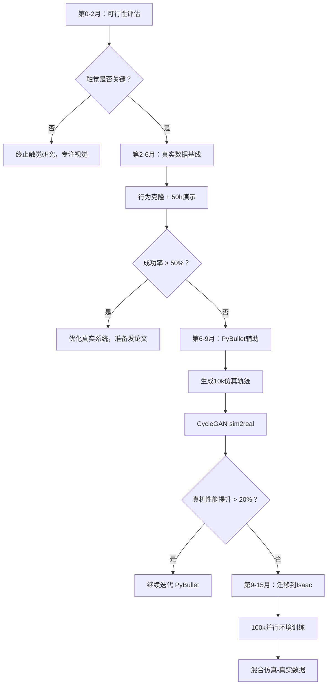

## 🤖 Assistant


# 触觉Sim-to-Real策略选择分析

## 快速建议：**选项 4 → 1 → 2 的渐进路线**

理由：触觉sim2real是**高风险高回报**领域，目前学术界尚无可靠的黑盒方案。你的项目处于早期阶段，应先用**最小成本验证核心假设**，再决定是否重投入仿真。

---

## 一、四个选项的深度对比

### 选项1：真实传感器 + 行为克隆（推荐起点）

**✅ 优势**
```
- 零sim2real gap（真实数据就是ground truth）
- 快速验证触觉对攀岩任务是否真的关键
- 人类演示数据质量高，学习曲线陡
- 3-6个月可出成果（发论文/演示）
- 硬件成本可控（GelSight Mini ~$500/个）
```

**❌ 劣势**
```
- 数据采集慢（人工遥操作）
- 样本效率低（需要数百小时演示）
- 泛化能力受限于演示多样性
- 难以探索危险/边界情况
```

**具体实施路线**
```python
# 第1-2月：最小可行系统
hardware = [
    "4×GelSight Mini (触觉)",
    "1×RealSense D435 (视觉)",
    "1×遥操作设备（spacemouse或VR手柄）",
]

data_collection_target = {
    'hours': 50,  # 人工演示时长
    'scenarios': [
        '平面岩点抓握',
        '边缘岩点',
        '滑移恢复',
    ],
    'success_rate': '>70%',  # 遥操作成功率
}

# 第3-4月：行为克隆基线
model = DiffusionPolicy(  # SOTA方法
    obs=['tactile', 'visual', 'proprio'],
    action_horizon=8,
)
train(model, demo_data, epochs=500)

# 第5-6月：闭环部署
deploy_real_robot(model)
eval_success_rate()  # 目标：>50% of human performance

# 关键验证点：触觉是否真的有用？
ablation_study = {
    'visual_only': train_without_tactile(),
    'tactile_only': train_without_visual(),
    'multimodal': train_full_model(),
}
# 如果 multimodal >> visual_only，证明触觉价值 → 转选项2
# 如果差异<10%，可能不需要触觉 → 省钱
```

**何时转向仿真**
- 真实数据采集速度成为瓶颈（单日<10条成功轨迹）
- 需要探索物理极限（大力抓握、快速动态）
- 需要大规模域泛化（数百种岩壁材质）

---

### 选项2：PyBullet + TACTO 基线（性价比之选）

**✅ 优势**
```
- 开发成本低（纯Python，笔记本可跑）
- TACTO是当前最成熟的触觉仿真
- 社区活跃，bug少
- 可快速迭代接触规划算法
- 样本无限（生成10万轨迹只需算力）
```

**❌ 劣势**
```
- PyBullet接触动力学过于简化（穿透、抖动）
- TACTO只支持平面传感器（GelSight），不支持曲面
- 光照模型简陋 → sim2real gap大
- 不支持GPU并行（单核100Hz vs Isaac 10万并行）
- 攀岩的大规模接触难以稳定
```

**适合的使用场景**
```python
# 场景A：接触序列规划的离线验证
mcts_planner = ClimbingMCTS(...)
for episode in range(10000):
    sequence = mcts_planner.search(init_state)
    reward = simulate_in_pybullet(sequence)
    # 快速迭代规划算法，不关心物理保真度

# 场景B：触觉特征学习的预训练
for material in ['granite', 'plastic', 'wood']:
    tactile_images = tacto.render(contact_force, material)
    train_feature_extractor(tactile_images)
# 得到一个粗糙的触觉编码器，真机上微调

# 场景C：sim2real方法的ablation study
datasets = {
    'sim_only': generate_tacto_data(10k),
    'sim+cyclegan': apply_cyclegan(sim_data, real_samples),
    'sim+domainrand': randomize_lighting(sim_data),
}
for name, data in datasets.items():
    model = train(data)
    real_perf[name] = eval_on_real_robot(model)
# 找出最有效的sim2real技术再上Isaac
```

**快速搭建代码**
```python
# pybullet_tactile_env.py
import pybullet as p
import tacto
import numpy as np

class ClimbingEnv:
    def __init__(self):
        self.client = p.connect(p.GUI)
        p.setGravity(0, 0, -9.81)
        
        # 加载攀岩墙和机器人
        self.wall = p.loadURDF("wall.urdf", [0, 0, 0])
        self.robot = p.loadURDF("climbing_robot.urdf", [0, -0.5, 1])
        
        # 触觉传感器（4个手指）
        self.digits = []
        for finger_id in [2, 4, 6, 8]:  # link IDs
            digit = tacto.Sensor(width=120, height=160)
            digit.add_camera(self.robot, [finger_id])
            self.digits.append(digit)
    
    def step(self, action):
        # 应用关节控制
        p.setJointMotorControlArray(
            self.robot, 
            range(12), 
            p.POSITION_CONTROL,
            targetPositions=action
        )
        p.stepSimulation()
        
        # 获取触觉观测
        tactile_obs = []
        for digit in self.digits:
            color, depth = digit.render()
            tactile_obs.append(color)
        
        # 检查接触稳定性
        contacts = p.getContactPoints(self.robot, self.wall)
        reward = self._compute_reward(contacts)
        
        return {
            'tactile': np.stack(tactile_obs),
            'proprio': self._get_joint_states(),
        }, reward, False, {}

# 2周可搭建完成，开始生成数据
```

---

### 选项3：Isaac Sim + 触觉插件（终极方案）

**✅ 优势**
```
- GPU并行：10万环境同时运行 → 1小时生成1年真实数据
- 物理保真度高（刚体、软体、流体都支持）
- 光追渲染 → 视觉真实感强
- 官方支持Omniverse → 可导入真实扫描的岩壁
- 与ROS2/Isaac SDK无缝集成
```

**❌ 劣势**
```
- 学习曲线陡（Python API不稳定，文档滞后）
- 硬件要求高（建议RTX 4090 or A6000）
- 触觉插件不成熟（TactoSense仅alpha版）
- 调试周期长（单个参数错误 → 重启5分钟）
- 商业授权不明确（学术免费，商用需谈）
```

**技术成熟度评估**
```python
# Isaac Sim 2023.1.1 实测（攀岩相关）

✅ 成熟功能：
- 刚体接触（摩擦、恢复系数）
- 大规模并行（10k+环境）
- URDF/MJCF导入

⚠️ 半成熟：
- 软体动力学（FEM求解器不稳定）
- 视触觉传感器（需自己写光线追踪shader）
- 域随机化（API频繁变动）

❌ 不支持：
- 真实材质的触觉纹理（石头摩擦声、微观形变）
- 磨损/老化模拟
- 动态地形生成
```

**何时值得投入**
1. 已在真实机器人上验证了触觉的关键性
2. 需要探索10+种岩壁材质/形状
3. 有GPU集群资源（>4×A100）
4. 团队有Omniverse经验（或愿意投入3+月学习）

**成本估算**
```
人力：1个全职工程师 × 3-6个月
硬件：RTX 4090 ($1600) 或 云GPU ($2-4/h × 500h = $1000-2000)
总计：~$5000-10000（不含人力）

对比真实机器人实验成本：
- 单次硬件损坏：$500-2000
- 10次摔坏 → 抵消仿真投入
```

---

### 选项4：可行性评估（最稳妥）

**核心问题清单**
```python
evaluation_checklist = {
    # Q1: 触觉对我的任务是否关键？
    'tactile_importance': {
        'method': '在简单场景用视觉+力传感器基线',
        'metric': '成功率 vs 人类演示时的触觉依赖度',
        'time': '2周',
        'pass_criteria': '视觉基线<50% AND 人类高度依赖触觉反馈',
    },
    
    # Q2: TACTO的保真度对我的任务够用吗？
    'sim_fidelity': {
        'method': '用GelSight采集10种岩石材质 → TACTO渲染对比',
        'metric': 'SSIM, LPIPS, 人眼AB测试',
        'time': '1周',
        'pass_criteria': 'SSIM > 0.7 OR 经过CycleGAN后>0.85',
    },
    
    # Q3: sim2real方法在触觉上的效果？
    'sim2real_feasibility': {
        'method': '文献调研 + 复现1-2篇SOTA',
        'papers': [
            'Tactile Sim-to-Real Policy Transfer (RSS 2021)',
            'Sim-to-Real via Sim-to-Sim (CoRL 2017)',
        ],
        'time': '2周',
        'pass_criteria': '在公开数据集上复现成功 → 转移成功率>60%',
    },
    
    # Q4: 我的数据采集能力？
    'data_collection_capacity': {
        'method': '试采集1天演示数据',
        'metric': '每小时有效轨迹数',
        'time': '3天',
        'pass_criteria': '<5 trajs/hour → 必须用仿真补充',
    },
    
    # Q5: 计算资源约束？
    'compute_budget': {
        'available': '本地GPU数量 + 云预算',
        'required': {
            'PyBullet': '1×1080Ti 够用',
            'Isaac': '4×4090 起步',
        },
        'decision': 'if budget < $5k: PyBullet; else: Isaac',
    },
}

# 执行评估
for q, spec in evaluation_checklist.items():
    result = run_evaluation(spec)
    print(f"{q}: {'PASS' if result.pass else 'FAIL'}")

# 决策树
if not tactile_importance.pass:
    return "不需要触觉，省钱"
elif data_collection_capacity.pass:
    return "选项1：真实数据优先"
elif sim2real_feasibility.pass and compute_budget >= 5k:
    return "选项3：Isaac Sim"
else:
    return "选项2：PyBullet基线"
```

---

## 二、推荐的渐进式路线（最优解）



**各阶段交付物**
```python
milestones = {
    'Month 2': {
        'deliverable': '触觉重要性评估报告',
        'decision': 'Go/No-go on tactile',
    },
    'Month 6': {
        'deliverable': '真实机器人演示视频（50% success）',
        'paper': '可投递 ICRA/IROS workshop',
    },
    'Month 9': {
        'deliverable': 'PyBullet仿真器 + sim2real基线',
        'metric': '仿真数据提升真机10%+',
    },
    'Month 15': {
        'deliverable': 'Isaac大规模训练 + 泛化评估',
        'paper': '可投递 CoRL/RSS',
    },
}
```

---

## 三、关键技术细节补充

### 如果选择选项1（真实优先），如何高效采集数据？

```python
# 高效遥操作系统设计
class TeleoperationSystem:
    def __init__(self):
        # 硬件
        self.spacemouse = SpaceMouse()  # 6DoF输入
        self.robot = ClimbingRobot()
        self.recorder = DataRecorder()
        
        # 关键：运动映射不是1:1，而是任务空间
        self.controller = CartesianImpedanceController(
            stiffness=[500, 500, 500, 50, 50, 50],  # 位置刚，姿态柔
        )
    
    def run_episode(self):
        """单次攀爬演示"""
        self.robot.reset_to_start_pose()
        
        while not done:
            # 1. 人类输入（6D末端速度）
            cmd_vel = self.spacemouse.read()
            
            # 2. 运动映射 + 安全限制
            cmd_vel = self.apply_safety_filter(cmd_vel)
            
            # 3. 记录多模态数据（重要！）
            obs = {
                'tactile': [cam.read() for cam in self.tactile_cams],
                'visual': self.realsense.read(),
                'proprio': self.robot.get_state(),
                'action': cmd_vel,  # 人类动作
                'timestamp': time.time(),
            }
            self.recorder.save(obs)
            
            # 4. 执行
            self.controller.step(cmd_vel)
            
            # 5. 自动标注（省人力）
            done = self._auto_detect_terminal_state()
        
        # 后处理：自动剪辑（去掉等待时间）
        self.recorder.trim_episode()
        return self.recorder.get_trajectory()
    
    def _auto_detect_terminal_state(self):
        """自动检测成功/失败（无需人工标注）"""
        if self.robot.reached_goal():
            return True, +1.0  # 成功
        elif self.robot.detect_fall():
            return True, -1.0  # 失败
        elif self.elapsed_time > 120:
            return True, 0.0   # 超时
        return False, 0.0

# 数据增强策略
def augment_demo(traj):
    """从单条轨迹生成多条变体"""
    augmented = []
    
    # 1. 时间伸缩（模拟不同速度）
    for scale in [0.8, 1.0, 1.2]:
        augmented.append(time_warp(traj, scale))
    
    # 2. 触觉噪声（模拟传感器差异）
    for noise_level in [0.01, 0.02]:
        augmented.append(add_tactile_noise(traj, noise_level))
    
    # 3. 初始状态扰动（提升鲁棒性）
    for delta in generate_start_perturbations(n=5):
        augmented.append(reexecute_with_offset(traj, delta))
    
    return augmented

# 预期采集效率
metrics = {
    'setup_time': '10 min/episode',  # 机器人复位
    'demo_time': '2-5 min/episode',  # 实际攀爬
    'success_rate': 0.7,             # 人类演示成功率
    'daily_output': '20-30 trajs',   # 每天有效数据
    'with_augment': '100-150 trajs', # 算上增强
}
```

### 如果选择选项2（PyBullet），如何最大化价值？

```python
# 专注于"不需要高保真物理"的子任务
useful_tasks_in_pybullet = {
    # ✅ Task 1: 接触序列搜索（只需拓扑正确）
    'contact_planning': {
        'what': '哪只手抓哪个岩点的组合优化',
        'why_sim_ok': '只需要运动学可达性，不需要精确动力学',
        'output': '粗糙的动作序列 → 真机上用RL微调',
    },
    
    # ✅ Task 2: 触觉特征预训练
    'tactile_pretraining': {
        'what': '学习从触觉图像提取"粗糙度""边缘"等特征',
        'method': 'TACTO生成100k样本 → 自监督学习（MAE/SimCLR）',
        'transfer': '特征编码器迁移到真机，只微调最后一层',
    },
    
    # ✅ Task 3: 失败模式分析
    'failure_detection': {
        'what': '训练"即将滑落"的检测器',
        'data': '仿真中故意制造滑移 → 收集触觉信号',
        'real_world': '真机安全气囊保护下验证',
    },
}

# 反面教材：不要在PyBullet里做这些
bad_tasks = {
    '❌ 精细动态运动': 'PyBullet的接触求解器不适合快速抓握',
    '❌ 材质判别': 'TACTO的材质库有限，无法泛化',
    '❌ 端到端策略': 'sim2real gap太大，真机崩溃',
}
```

### 如果选择选项3（Isaac），如何降低风险？

```python
# 分阶段投入，避免一次性赌博
isaac_phased_approach = {
    # Phase 1: 验证（2周，免费）
    'proof_of_concept': {
        'goal': '确认Isaac能跑通攀岩场景',
        'tasks': [
            '导入机器人URDF',
            '创建简单岩壁（10个岩点）',
            '单环境闭环控制',
        ],
        'success_criteria': '接触力稳定，无穿透/爆炸',
        'resource': '笔记本RTX 3060 + Isaac Sim免费版',
    },
    
    # Phase 2: 小规模并行（1月，$500）
    'scale_test': {
        'goal': '验证并行效率',
        'tasks': [
            '1k并行环境',
            '训练简单抓握策略（PPO 1M steps）',
            '测量训练速度',
        ],
        'success_criteria': '>100 FPS总吞吐量',
        'resource': 'AWS g5.12xlarge × 40h',
    },
    
    # Phase 3: 全面部署（3月，$5k）
    'full_deployment': {
        'goal': '生产级训练流水线',
        'tasks': [
            '10k并行 + 域随机化',
            '完整触觉集成',
            'sim2real验证',
        ],
        'resource': '本地4×4090 OR 云GPU长期合约',
    },
}

# 失败快速止损策略
if phase1_fails:
    loss = 40_hours × $100/h = $4k  # 人力成本
    pivot = "回退到PyBullet"
elif phase2_fails:
    loss = $4k + $500 = $4.5k
    pivot = "混合方案：PyBullet预训练 + 少量真实数据"
else:
    proceed_to_phase3()
```

---

## 四、最终决策建议

### 如果你的项目满足以下条件 → 选**选项1**
```
✅ 6个月内需要演示成果（毕业/融资/论文）
✅ 有遥操作设备和人力
✅ 机器人已经搭建完成
✅ 首次尝试触觉机器人（不确定触觉价值）
```

### 如果你的项目满足以下条件 → 选**选项2**
```
✅ 已验证触觉的关键性
✅ 计算预算有限（<$2k）
✅ 需要快速迭代算法（如接触规划）
✅ 对sim2real gap有心理预期（60-70%真机性能）
```

### 如果你的项目满足以下条件 → 选**选项3**
```
✅ 长期项目（1-2年周期）
✅ 有GPU集群或充足云预算（>$5k）
✅ 需要探索大量变体（岩壁/材质/形状）
✅ 团队有图形学/物理仿真背景
```

### 无论如何都建议先做**选项4**
```
因为评估本身只需 2-4周，但能避免：
- 6个月后发现触觉没用（浪费$20k）
- 投入Isaac后发现PyBullet够用（浪费$10k）
- 忽略真实数据的价值（错失最优路线）
```

---

## 五、我的个人建议（基于你的上下文）

从你之前的问题（强化学习、接触规划、触觉融合网络）判断，你的项目处于**早期研究阶段**，
