# 硬件采购清单 (Hardware Procurement Checklist) — Gate 4 前置

> **日期**: 2026-10-08
> **用途**: Gate 4 的关键路径是**硬件到货**。本文档列出 Phase P1-P8 全部外部依赖的硬件采购清单，按 BOM 关联度和采购周期排序。
> **采购原则**: 一次采购到位，避免分批补单（每批 2-4 周物流）。所有型号都是 **候选推荐**，最终以机械/电气工程师实际选型为准。
> **预算参考**: 全套 ~¥15,000-25,000 CNY（不含 Jetson）；单臂最小化版 ~¥6,000-10,000 CNY。

---

## 一、采购清单总览

| 组 | 组件 | 数量 | 预算 (CNY) | 采购周期 | 关联任务 | 优先级 |
|---|---|---|---|---|---|---|
| **A. 主控** | Jetson Orin NX 16GB + 载板 | 1 | ¥8,000-10,000 | 2-4 周 | P8 / VLA 训练推理 | ⭐⭐⭐ 必须 |
| **B. 腱驱动电机** | BLDC 无刷电机 (24V, 200KV, 7pp) | 8 | ¥1,600-3,200 | 2-3 周 | B1 / L4 | ⭐⭐⭐ 必须 |
| **C. 腱驱动减速器** | Harmonic Drive / Planetary (K_j=5000) | 8 | ¥3,200-6,400 | 4-6 周 | L6 / VSA | ⭐⭐⭐ 必须 |
| **D. 编码器** | AS5048A (14-bit) 或 TLI5012B (19-bit) | 16 | ¥800-1,600 | 2-3 周 | B1 / FOC | ⭐⭐⭐ 必须 |
| **E. 电池** | 21700 Li-ion 48V 320Wh (13S x N P) | 1 | ¥1,500-2,500 | 1-2 周 | BMS / 续航 | ⭐⭐ 必须 |
| **F. 腱张力传感器** | 应变片 + AD8422 仪表放大 | 8 | ¥600-1,200 | 2-3 周 | L4 / 腱张力 | ⭐⭐ 必须 |
| **G. 触觉传感器** | GelSight Mini / 自研 (D4.1) | 4-10 | ¥2,000-6,000 | 4-6 周 | L4 / 触觉闭环 | ⭐⭐ 必须 |
| **H. CAN-FD 收发器** | TCAN1043A-Q1 + CAN 卡 | 10 + 1 | ¥500-1,000 | 1 周 | B1 / 通信 | ⭐⭐⭐ 必须 |
| **I. PCB 打样** | B1 板 5 层 (4 layer, 2 oz) | 5-10 | ¥200-500 | 7-10 天 | P2 / FOC | ⭐⭐⭐ 必须 |
| **J. 示波器** | ≥100 MHz 4 通道 (或外借) | 1 | ¥5,000-15,000 | 外借/采购 | P1 / P2 关机链实测 | ⭐⭐⭐ 必须 |
| **K. 机械结构件** | 连杆 / 轴承 / 3D 打印 / 紧固件 | 1 批 | ¥2,000-4,000 | 1-2 周 | L7 / 组装 | ⭐ 必须 |
| **L. 攀岩墙/hold** | 木质墙 + 树脂 hold 12+ | 1 套 | ¥1,500-3,000 | 1-2 周 | L1 / Phase A 场景 | ⭐⭐ 必须 |
| **M. 安全绳** | 动力绳 + 安全带 | 1 套 | ¥300-500 | 1 周 | 场景安全 | ⭐⭐ 必须 |

**总计**: ~¥26,000-55,000 CNY（全套）；**最小可运行版** ~¥12,000-18,000 CNY（单臂 + 无触觉）

---

## 二、详细选型建议

### A. Jetson Orin NX 16GB

| 项 | 推荐 | 备选 | 说明 |
|---|---|---|---|
| 载板 | Seeed J301 / Auvidea X2301 | Dev Kit | Dev Kit 开发方便，载板部署稳定 |
| 存储 | NVMe SSD 512 GB | 1 TB | 数据集 + 检查点 + 系统 |
| 散热 | 官方风扇散热片 | 定制水冷 | 25W TDP 主动散热必需 |
| 电源 | 19V DC 6.32A | 9-20V 宽压 | 电池 + DC-DC 变换 |

**验证用例**: `jetson_bench.py` roofline 基准 (INT8: 100 TOPS 理论, FP16: 50 TOPS)。

### B. 腱驱动电机 (B1 关键器件)

**需求** (来自 `contracts/hw_requirements.yaml`):
- 额定力矩: ≥1.4 Nm (经减速器)
- 峰值电流: 4 A (相)
- 母线: 24 V (通道级 buck 从 48 V)
- 极对数: 7 (推荐)，Kt ≈ 0.13 Nm/A
- 编码器接口: SPI (AS5048A) 或 SSI (TLI5012B)

**候选型号**:
| 型号 | 参数 | 价格 | 说明 |
|---|---|---|---|
| **T-Motor MN3508** | 340 KV, 24 poles, 19 g | ¥150 | 轻量化，适合小型关节 |
| **T-Motor U8 Lite** | 85 KV, 24 poles, 220 g | ¥400 | 大扭矩，需要高减速比 |
| **iPower GBM5208** | 150 KV, 14 poles, 210 g | ¥280 | 中等规格 |
| **RM 3508 (大疆)** | 内置减速器 1:19, 48 poles | ¥800 | 一体化，但极对数多 FOC 更难 |

**推荐**: T-Motor MN3508 × 8（单臂 4 关节 × 2）+ 减速器 1:20 → 输出 ~10 Nm。

### C. 减速器

**需求**: K_j = 5000 Nm/rad (VSA 需要)，传动比 1:10-1:30，输出 ≥10 Nm。

**候选**:
| 型号 | 参数 | 价格 | 说明 |
|---|---|---|---|
| **Harmonic Drive CSD-14** | 1:50, K_j ~8000 | ¥800-1500 | 轻量，零回差 |
| **Planetary 1:20 (沛智/Neugart)** | K_j ~5000 | ¥300-800 | 性价比高 |
| **Cycloidal 精密摆线** | K_j ~3000 | ¥200-500 | 自制便宜，但精度略差 |

**推荐**: Planetary 1:20 × 8（性价比高）；VSA 关节（拮抗双腱）用 Harmonic Drive。

### D. 磁编码器

**契约要求**: `absolute_19bit` (B1 契约) 但元件库只有 AS5048A (14-bit) — **known_gap 已记录**。

| 型号 | 分辨率 | 接口 | 价格 | 说明 |
|---|---|---|---|---|
| **AS5048A** | 14-bit (16384) | SPI / PWM | ¥50 | 契约 known_gap 提到 |
| **TLI5012B** (英飞凌) | 15-bit (32768) | SSI / SPI | ¥80 | 19-bit 视角 (角度细分) |
| **AM4096** (RLS) | 12-bit | 多协议 | ¥120 | 高精度但较贵 |
| **AksIM-2** (RLS) | 17-20 bit | BiSS | ¥2000+ | 高端 |

**推荐**: **TLI5012B × 16**（16 通道 8 双端），直接满足契约 19-bit 视角（即使物理 15-bit）。AS5048A 作 backup。

### E. 电池

**契约**: 48 V / 320 Wh (21700 化学体系)

| 型号 | 参数 | 价格 | 说明 |
|---|---|---|---|
| **三星 INR21700-50E** | 5000 mAh, 3.6V, 9.8A | ¥30/节 | 高容量低倍率 |
| **Molicel P42A** | 4200 mAh, 3.6V, 45A | ¥45/节 | 高倍率 |
| **组装**: 13S6P (48V 25.2Ah = 1210 Wh) | | ¥1,500-2,500 | 13S x 6P = 78 节 |

**推荐**: 13S4P Molicel P42A = 48V 16.8Ah = **806 Wh** (够攀岩 15 min 竞技，超过契约 320 Wh)。
配套 BMS: 13S 60A JBD 智能保护板 (¥200)。

### F. 腱张力传感器

**契约**: 8 个张力负载单元 (B1 契约)

**推荐**: 应变片 (BF350-3AA) + AD8422 仪表放大（契约要求）× 8 = ¥75/套 × 8 = ¥600
配套 10 kg S 型梁传感器 (¥60/个) 用于标定。

### G. 触觉传感器

**契约**: 100 Hz / 8×8 阵列（假设）

**候选**:
| 方案 | 帧率 | 分辨率 | 价格 | 说明 |
|---|---|---|---|---|
| **GelSight Mini** | 25 Hz | 400×400 | ¥3,000/个 | 商用成熟 |
| **DIGIT (Meta 开源)** | 60 Hz | 320×240 | ¥800/个 (自组装) | 开源可 DIY |
| **uSkin (IIT)** | 100 Hz | 3×3 taxel × 3 轴 | ¥2,000/个 | 三轴力 |
| **自研压阻阵列** | 100 Hz | 8×8 | ¥100/个 | 简单方案 |

**推荐**: **DIGIT 自组装 × 10**（每指尖 + 每掌面）—— 性价比高 + 开源驱动兼容。

### H. CAN-FD 收发器 / 卡

**契约**: CAN-FD 5 Mbps / 8 节点

| 组件 | 型号 | 数量 | 价格 |
|---|---|---|---|
| 收发器 | TCAN1043A-Q1 SOIC-8 | 10 | ¥20/个 = ¥200 |
| CAN 分析卡 | CANable Pro (candleLight) | 1 | ¥250 |
| CAN 线缆 + 端子 | 120Ω 双绞 + D-SUB | 1 套 | ¥100 |

### I. PCB 打样 (B1 板)

**打样清单** (见 [artifacts/b1_tendon_drive_package/B1_prototyping_list.html](../artifacts/b1_tendon_drive_package/B1_prototyping_list.html)):
- 层数: 4 层
- 铜厚: 2 oz
- 板厚: 1.6 mm
- 尺寸: ~55×45 mm
- 数量: 5-10 片
- 厂家: 嘉立创 / 华秋
- 费用: ~¥300-500

**前置条件**: 必须由 Layout 工程师基于 `B1_tendon_drive.circuit.json` 完成真实 PCB Layout（Altium/KiCad），自动布局不可直接投板。

### J. 示波器

**需求**: Phase P1 关机链 <1 µs 实测，需要 ≥100 MHz 带宽。

| 型号 | 带宽 | 通道 | 价格 | 说明 |
|---|---|---|---|---|
| **Rigol DHO804** | 70 MHz | 4 | ¥3,500 | 入门 |
| **Siglent SDS1104X-U** | 100 MHz | 4 | ¥4,500 | 性价比 |
| **Rigol MSO5104** | 100 MHz | 4 | ¥8,000 | 中端 |
| **Keysight DSOX1102A** | 100 MHz | 2 | ¥12,000+ | 品牌 |

**推荐**: **Siglent SDS1104X-U** + 电流探头 (¥1,500) + 差分探头 (¥800)。

---

## 三、采购时序建议

```mermaid
gantt
    title 硬件采购与到货时序 (相对 T0 = 决策日)
    dateFormat X
    axisFormat %s周
    section 周期短 (1-2 周)
    CAN 卡 + 收发器           :a1, 0, 1
    电池 13S4P                :a2, 0, 2
    机械结构件                :a3, 0, 2
    攀岩墙 + hold             :a4, 0, 2
    安全绳                    :a5, 0, 1
    section 周期中 (2-4 周)
    B1 PCB 打样 (10 天)       :b1, 0, 2
    Jetson Orin NX            :b2, 0, 3
    T-Motor 电机 ×8           :b3, 0, 3
    编码器 ×16                :b4, 0, 3
    腱张力传感器 ×8           :b5, 0, 3
    section 周期长 (4-6 周)
    Harmonic Drive 减速器     :c1, 0, 5
    DIGIT 触觉传感器          :c2, 0, 5
    示波器                    :c3, 0, 4
```

**最小启动集** (T0+2 周内到货): PCB + 电机 + 编码器 + CAN 卡 + 电池 → 可启动 P1/P2 部分 HIL
**完整启动集** (T0+5 周内到货): + 减速器 + 触觉传感器 + 示波器 → 可启动全部 Phase P

---

## 四、验收与到货检测流程

每个组件到货后按以下流程验收：

| 步骤 | 内容 | 通过判据 |
|---|---|---|
| 1. 外观 | 无明显损坏、引脚完好 | 视检 |
| 2. 电气 | 用万用表测关键引脚短路/开路 | 与 datasheet 一致 |
| 3. 功能 | 上电最小系统测试（或退回） | 响应正确 |
| 4. 精度 | 编码器 / 传感器标定 | 误差 <1% FS |
| 5. 入库 | 登记 SN、贴标签、记 provenance | 记录完整 |

**统一到货登记表**: `experiments/hardware_inventory.csv`（AI 侧准备）

---

## 五、Gate 4 就绪清单

- [ ] B1 PCB Layout 工程师评审通过
- [ ] B1 PCB 打样并到货 5-10 片
- [ ] Jetson Orin NX 到货 + JetPack 刷机
- [ ] 电机 8 个 + 减速器 8 个 + 编码器 16 个 到货 + 编号
- [ ] 触觉传感器 × 10 到货
- [ ] CAN 卡到货 + 多节点通信测试
- [ ] 电池 13S4P + BMS 到货 + 安全测试
- [ ] 示波器 + 探头到位
- [ ] 攀岩墙搭建（≥12 hold）
- [ ] 机械结构件 CNC/3D 打印 完成
- [ ] `experiments/hardware_inventory.csv` 完整
- [ ] `docs/15-hil-test-protocol.md` 全流程准备就绪

**以上全部就绪 → 进入 [docs/15-hil-test-protocol.md](15-hil-test-protocol.md) Phase P 48 小时 HIL 流程**
