# HIL 实测协议 (Hardware-in-the-Loop Test Protocol) — Phase P 48 小时启动流程

> **日期**: 2026-10-08
> **用途**: 硬件到货后的**第一批 48 小时**决定整个 Phase P 的节奏。本文档把 [docs/11 §六 Phase P](11-production-upgrade-roadmap.md) 的 P1-P8 细化为可执行的分阶段协议。
> **关键原则**: 所有实测数值**必须**注入 `contracts/safety_budget.yaml` 或 `contracts/hw_requirements.yaml` 对应字段，且 `assumed_*` 字段必须被实测值**替换**（不许并留）。每次实测落盘后自动记录到 `experiments/hil_measurements/YYYYMMDD_*.json`。
> **协议前提**: [docs/14-hardware-procurement-checklist.md](14-hardware-procurement-checklist.md) 全部就绪；B1 PCB Layout 工程师评审通过并打样到货。

---

## 一、48 小时目标速览

| 小时 | 目标 | 交付 | 涉及 Phase P 任务 |
|---|---|---|---|
| **H0-H4** | 到货清点 + 静电防护 + 上电检查 | `hardware_inventory.csv` 登记 | — |
| **H4-H12** | Jetson 刷机 + CAN 总线打通 | JetPack + `candump` 双向通信 | P6 部分 |
| **H12-H24** | 单关节台架：电机 + 编码器 + 驱动板 | FOC 开环旋转 + 编码器读数稳定 | P2 前置 |
| **H24-H36** | 关机链实测：示波器捕获 4 段时序 | 4 组示波器截图 + 数值 | **P1 核心** |
| **H36-H48** | 数据注入 + `verify` 转绿 | `safety_budget.yaml` `measured_*` 覆盖 ≥50% | P1 验收 |

---

## 二、H0-H4: 到货清点与静电防护

### 2.1 环境准备

- 防静电手环 + 防静电垫 (必须)
- 温度 15-30°C，湿度 30-70% RH
- 万用表 + 逻辑分析仪 (Saleae Logic 8 或同等)
- 隔离 DC 电源 (30V / 10A)
- `experiments/hil_measurements/` 目录建立

### 2.2 到货清点流程

```bash
# 1. 按 docs/14 清单逐项核对 SN
python scripts/hardware_inventory.py --check-list docs/14-hardware-procurement-checklist.md
# 2. 扫描二维码/条码录入
python scripts/hardware_inventory.py --scan --component motor --qty 8
# 3. 上传照片 (可选)
python scripts/hardware_inventory.py --attach-photo motor_SN001.jpg
```

### 2.3 通过判据

- [ ] 全部组件有 SN 编号
- [ ] 外观无损坏
- [ ] 关键引脚万用表测试通过
- [ ] `hardware_inventory.csv` 齐全

---

## 三、H4-H12: Jetson 刷机 + CAN 总线

### 3.1 Jetson Orin NX 刷机

```bash
# 主机 (x86 Linux) 上:
sdkmanager --cli install --target JETSON_ORIN_NX_TARGETS \
  --target-os Linux --version JetPack-6.0 --select 'CUDA-X AI' --select 'TensorRT'

# 刷完之后在 Jetson 上验证:
nvidia-smi                      # GPU 可见
python3 -c "import torch; print(torch.cuda.is_available())"  # True
```

### 3.2 CAN-FD 总线打通

**接线**: Jetson CAN0 → CANable Pro → B1 板 CAN0 (TCAN1043A)

```bash
# Jetson 上:
sudo modprobe can can_raw mttcan
sudo ip link set can0 up type can bitrate 1000000 dbitrate 5000000 fd on
candump -L can0 &

# 主机上 (CANable):
cangen can0 -v
# → Jetson 端 candump 应收到帧
```

**通过判据**:
- [ ] `candump` 收到帧
- [ ] DBC 解码正常 (`python -m embodied_ai.can_decode --dbc contracts/canfd/joint_control.dbc`)
- [ ] B1 板响应 CAN-FD 5 Mbps
- [ ] CRC8 (poly 0x07) 双向一致

---

## 四、H12-H24: 单关节台架

### 4.1 台架搭建

```
[隔离电源 24V] → [B1 驱动板] → [电机 MN3508 + 减速器 1:20] → [编码器 TLI5012B]
                                         ↓
                              [Jetson Orin NX] ← CAN-FD →
```

### 4.2 开环旋转测试 (SVPWM 验证)

```bash
# 在 Jetson 上:
cd EmbodiedAI
python -m embodied_ai.cli foc_open_loop --joint j1 --speed 1.0 --duration 5
# 预期: 电机平滑旋转 5 秒，无抖动
```

**验证** (对应 `foc_shutdown.py` SVPWM):
- [ ] `foc_open_loop` 成功旋转
- [ ] `verify_motor_spec` 三方校验 (Ke/Kt/ψ/pp) 全绿
- [ ] 相电流波形 (示波器 10 ms/div) 正弦对称

### 4.3 闭环电流环测试

```bash
python -m embodied_ai.cli foc_current_loop --joint j1 --target-iq 2.0 --duration 10
# 预期: 电流环稳定收敛，jitter <5%
```

**验证**:
- [ ] `Id` 稳定在 0 ±0.2 A
- [ ] `Iq` 跟踪 2.0 ±0.1 A
- [ ] 电流环带宽实测 >800 Hz (设计值)
- [ ] 温升 <10°C (10 分钟)

### 4.4 编码器测试

```bash
python -m embodied_ai.cli encoder_test --joint j1 --samples 1000
# 预期: 编码器读数稳定，无跳变，绝对位置正确
```

**验证**:
- [ ] 1000 次读数标准差 <0.01°
- [ ] 绝对位置上电后立即正确 (无需回零)
- [ ] 双端编码器 (电机端 + 腱端) 同步

---

## 五、H24-H36: 关机链实测 (Phase P1 核心)

### 5.1 测试装置

```
[信号发生器 触发信号] → [B1 板 硬件比较器] → [MOSFET 栅极] → [电机相线]
         ↓                                        ↓
    [示波器 CH1: 触发信号]              [示波器 CH2: 栅极]
         ↓                                        ↓
    [示波器 CH3: 相电流]                [示波器 CH4: 过温信号]
```

### 5.2 四段关断时序 (对应 `safety_budget.yaml`)

按 `assumed_*` → `measured_*` 顺序，逐段注入：

#### 段 1: 电气关断 (electricalUs, 期望 <1 µs)

```bash
# 示波器设置: 500 ns/div, 触发 CH1 上升沿
python -m embodied_ai.cli foc_shutdown_test --stage electrical --trials 100
```

**测量**: CH1 触发到 CH2 MOSFET 关断的延迟
**通过判据**: 100 次测试 median <1 µs, max <1.5 µs

#### 段 2: 电弧熄灭 (arcMs, 期望 <8 ms)

```bash
# 示波器: 2 ms/div
python -m embodied_ai.cli foc_shutdown_test --stage arc --trials 50
```

**测量**: CH3 相电流从过流值到 0 的时间
**通过判据**: 50 次测试 median <8 ms, max <12 ms

#### 段 3: 机械隔离 (mechIsolationMs, 期望 <8 ms)

```bash
# 用高速摄像机或加速度计
python -m embodied_ai.cli relay_clutch_test --stage mechanical --trials 20
```

**测量**: 离合器啮合时间 (从电信号到机械分离)
**通过判据**: 20 次测试 median <8 ms, max <12 ms

#### 段 4: 总链路 (总 <16 ms, 预算 20 ms)

```bash
python -m embodied_ai.cli foc_shutdown_test --stage total --trials 20
```

**通过判据**: 总延迟 <16 ms (20 ms 预算 - 20% 裕量)

### 5.3 数据注入

```bash
# AI 侧准备好注入脚本
python scripts/inject_hil_measurements.py \
  --stage electrical --measured-us 0.85 --trials 100 --source "Rigol DHO804 SN-XXX" \
  --stage arc --measured-ms 7.2 --trials 50 --source "Rigol DHO804 SN-XXX" \
  --stage mechanical --measured-ms 6.8 --trials 20 --source "高速相机 1000fps"

# 自动更新 contracts/safety_budget.yaml:
#   electricalUs: 0.8 → measured_us: 0.85, validation_status: validated
#   arcMs: 8 → measured_ms: 7.2, validation_status: validated
#   mechIsolationMs: 8 → measured_ms: 6.8, validation_status: validated
# 并记录到 experiments/hil_measurements/20261008_shutdown_chain.json
```

**验收**: `verify --no-pytest` 输出 `safety_budget_measured_coverage ≥50%`

---

## 六、H36-H48: 数据注入 + verify 转绿

### 6.1 全部 P1 数据注入

| 字段 | 原值 (assumed) | 实测来源 | 注入脚本 |
|---|---|---|---|
| `electricalUs` | 0.8 | 示波器 CH1→CH2 延迟 | `inject_hil_measurements.py --stage electrical` |
| `arcMs` | 8 | 示波器 CH3 电流衰减 | `inject_hil_measurements.py --stage arc` |
| `mechIsolationMs` | 8 | 高速相机 | `inject_hil_measurements.py --stage mechanical` |
| `totalShutdownMs` | 16 | 三段和 | 自动累加 |
| `pfh_per_hour` | 6.6e-8 | 实测 + 1oo2 建模 | `recalc_pfh.py --hft 1oo2` |
| `safe_failure_fraction` | 96.9% | 元件 MTBF 实测 | `recalc_sff.py --mtbf-file ...` |
| `hardware_shutdown_us` | 1.0 | 实测 | 同 electricalUs |
| `overtemp_shutdown_c` | 105 | 温度传感器标定 | `calibrate_thermal.py` |
| `overcurrent_threshold_a` | 40 | 电流探头实测 | `calibrate_overcurrent.py` |

### 6.2 Phase P2 数据注入

| 字段 | 原值 | 实测 | 脚本 |
|---|---|---|---|
| `motor_pole_pairs` | 7 | 编码器信号分析 | `identify_motor_params.py --pp` |
| `motor_ld_uh`, `motor_lq_uh` | 15/28 | LCR 表 + 锁定转子 | `identify_motor_params.py --ldlq` |
| `motor_flux_linkage_mwb` | 2.8 | 反电动势测试 | `identify_motor_params.py --flux` |
| `motor_resistance_mohm` | 50 | 直流压降法 | `identify_motor_params.py --rs` |
| `vla_inference_ms` | 20 | Jetson 实测 | `python -m embodied_ai.cli bench --measured-ms` |
| `control_loop_jitter_us` | <100 | Jetson 实测 | `python -m embodied_ai.cli bench --jitter` |

### 6.3 最终验收

```bash
# 1. verify 全绿
python -m embodied_ai.cli verify --no-pytest
# 预期: N/N PASS + RESULT=VERIFY_OK (N = verification.CHECKS 项数, 当前 35)
#       判据是"全部通过", 不是某个具体数字 —— 项数会随能力增长。

# 2. pytest 全绿
python -m pytest tests/ -q
# 预期: 全部 passed (+ 环境性 skip, 如无 checkpoint 时)

# 3. selfcheck 全绿
python -m embodied_ai.cli selfcheck
# 预期: 5/5 SELF_CONTAINED_OK

# 4. assumed_* 占比
python -m embodied_ai.cli verify --safety-budget-report
# 预期: assumed_* 占比 <50%, measured_* 占比 >50%
```

---

## 七、Phase P 完整时间表 (硬件到货后)

```mermaid
gantt
    title Phase P 完整时间表 (T0 = 硬件到货日)
    dateFormat X
    axisFormat %s天
    section P1 HIL 实测 (3-5 天)
    48h 冲刺 (到货→数据注入)      :p1a, 0, 2
    补充实测 (剩余参数)           :p1b, 2, 3
    section P2 FOC 打样 (1-2 周)
    7 条 HIL 用例跑完             :p2, 2, 7
    section P3 安全认证 (2-4 周)
    PFH 按 1oo2 重算             :p3, 5, 10
    RTM 全链接实测               :p3b, 10, 20
    section P4 真机四步通电 (2 周)
    ①电机单关节台架              :p4a, 2, 3
    ②指尖传感器标定              :p4b, 3, 6
    ③整机静态悬挂                :p4c, 6, 10
    ④首 dyno                    :p4d, 10, 14
    section P5-P8 并行
    GUI 互锁                     :p5, 2, 3
    双仓 CI                      :p6, 3, 5
    edalabcore 单测              :p7, 3, 7
    性能验收                     :p8, 5, 12
```



**总计**: ~4-6 周从硬件到货到 Gate 4 达成。

---

## 八、失败回退协议

| 阶段 | 失败 | 回退动作 |
|---|---|---|
| H12-H24 | 电机不转 | 检查相序/驱动板焊点/供电 → 排除后重测 |
| H24-H36 | 关断 >1 µs | 检查比较器选型 (响应时间) / PCB 走线长度 → 若硬件缺陷需改板 |
| H24-H36 | 电弧 >8 ms | 检查 RC 熄弧参数 → 若无法 <8 ms 更换继电器型号 |
| H36-H48 | verify 不转绿 | 检查 `assumed_*` 替换是否完整 / `safety_budget.yaml` schema 是否匹配 |
| P4 任一步失败 | 真机动作异常 | 回退到仿真标定，记录失败数据用于 RL 训练 (`FailureReplayBuffer`) |

---

## 九、Gate 4 达成判定 (最终)

**全部满足以下条件即宣告 Gate 4 达成**:

- [ ] P1 HIL 实测完成：`safety_budget.yaml` `measured_*` 占比 >50%
- [ ] P2 FOC 打样：7 条 HIL 用例全部通过
- [ ] P3 安全认证：PFH 按 1oo2 建模，RTM 全链接实测证据
- [ ] P4 真机四步通电：① 电机单关节 → ② 传感器标定 → ③ 整机静态悬挂 → ④ 首 dyno 全通过
- [ ] P5 GUI 互锁：resume 二次确认 token 生效
- [ ] P6 双仓 CI：EmbodiedAI + EdaLab CI 全绿
- [ ] P7 edalabcore 单测：VSA / RelayClutch / MultiPhysics 三引擎核心路径 >80% 覆盖
- [ ] P8 性能验收：VLA <50 ms @ 20 Hz；控制环 1 kHz jitter <100 µs
- [ ] **对外口径可宣称**: "可上真机的产品"

---

## 十、协议维护

- **每次实测后**: `git commit` 附带 `hil_measurements/` 下的 JSON 文件
- **每周汇总**: `python scripts/hil_progress_report.py` 生成周报
- **异常处理**: 失败记录写入 `experiments/hil_failures/YYYYMMDD_*.json`（与成功同等价值）
- **文档同步**: 本协议任何修改必须同步到 `CHANGELOG.md`
