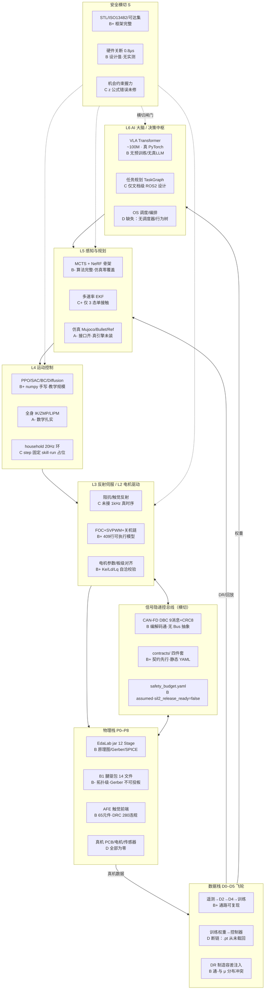

# EmbodiedAI 全链路能力与不足审计

> **日期**: 2026-10-08  
> **范围**: 自动化底层硬件设计 → 信号/总线 → 电机执行 → 控制/感知 → 仿真/HIL → 数据飞轮 → OS 决策中枢  
> **基线**: v0.9 Gate 2（verify 28/28、pytest 441 passed）+ 本次三层实测剖析  
> **口径**: 五级 — S 生产可用 / A 可验证研究级 / B 设计+原型可跑 / C 设计为主 / D 空白

---

## 〇、一句话总判

本项目是**数字样机完备、物理样机为零**的具身智能全栈工程：三轴（控制 L / 物理 P / 数据 D）+ 安全横切 S 的**分层骨架与契约体系已立住**，且验收工程化（S 级）罕见地强；但**跨层"信号隐递控总线"只有静态契约、没有运行时消息中枢**，**训练→部署飞轮断在最后一环**，**上层 OS 决策中枢尚不存在**（只有 CLI + 描述性仪表盘）。全链条完成度约 **45–55%**（软件侧 ~70%，硬件侧 0%）。

---

## 一、全链路分层能力地图



---

## 二、分层能力详评

### 2.1 自动化底层硬件设计（P 轴）— **B**（设计级完备，制造级缺口）

**已经做到的**（jar 单仓自足，12 Stage live 全绿）：

- **设计自动化主链**：`vendor/edalab/edalabcore.jar` 一键产出原理图 SVG、PCB JSON/SVG/DXF、Gerber、SPICE 网表、C 文件、BOM（`artifacts/b1_tendon_drive_package/` 14 文件；`scripts/export_b1_package.py`）。
- **触觉 AFE 前端**：仪表放大 201× + PGA → 60.40dB / 10.6kHz 带宽，65 元件 PCB，SPICE AC/瞬态收敛，经 `adapters/afe_ind.py` 回写契约。
- **电机/驱动工程模型**：`foc_shutdown.py` 409 行完整 SVPWM+Clarke/Park+电流 PI+四段关机链（伏秒平衡 5e-15）；`motor_model.py` 补全 Ke/flux/Ld/Lq/Rs 并三方校验；`foc_board_align.py` 板级参数交叉对齐（抓到 0.014% 增益漂移）。
- **灵巧手选型**：3/5 指、全驱动/腱欠驱动矩阵 + ε 力闭合 argmax（`dexterous_hand.py`），已数值接入攀岩抓握。

**明确不足**（按严重度）：

| # | 缺口 | 证据 | 影响 |
|---|------|------|------|
| H1 | **Gerber 不可直接投板** | 仅 5 层 .gbr；无 drill/阻焊/钢网/底丝印；元件坐标全 14mm 网格 | 无法打样 |
| H2 | **"固件生成"是伪的** | `B1_tendon_drive.c` 只是网表数据表 + print，无 FOC ISR/HAL/寄存器 | MCU 不可烧录 |
| H3 | **SPICE 极浅** | `.cir` 仅 2 电容入网表，MOSFET/IC/MCU 全跳过 | 无开关波形/环路仿真 |
| H4 | **DRC 不收敛** | AFE 报告 280 违规；B1 自认无 SI/PI/EMC | 制造风险 |
| H5 | **无总线/接口抽象** | CAN-FD 埋在 `real_robot_env` 函数里，无 HAL/BSP；EtherCAT/SPI/RS485 全无 | 跨层耦合 |
| H6 | **腱绳/灵巧手链未闭合** | 仅选型结论，无滑移/迟滞/疲劳；无驱动电路与触觉融合 | 手爪不可造 |

### 2.2 信号隐递控总线（横切通信契约）— **B+ 契约 / D 运行时**

这是全链路"精妙"的枢纽，也是**最大的结构性缺口**。

**已经做到的**：
- **契约先行**：`contracts/` 四件套机器可校验 — `hw_requirements.yaml`（AI 策略→硬件规格）、`safety_budget.yaml`（分段延迟预算 + provenance 诚实化）、`canfd/joint_control.dbc`（9 消息 + CRC8 覆盖）、`dr_params/manufacturing_variance.yaml`（制造容差→DR）。
- **CAN-FD 编解码**：`real_robot_env.py` 对齐 DBC，600 帧 0 失配；Mock/SocketCAN/Serial 三传输层可替换。
- **安全预算不可挪用**：电气关断 0.8µs → 熄弧 8ms → 机械隔离 8ms ≈ 16ms < 20ms 预算；`budget_closure.py` 按 provenance confidence 决定是否参与闭环。
- **诚实边界**：`assumed_*` 重命名 + `sil2_release_ready: false` + provisional 降级——循环自证已消除。

**明确不足**：

| # | 缺口 | 说明 |
|---|------|------|
| B1 | **无运行时消息总线** | 层间靠 Python `import` 直调；无 pub/sub、无 DDS、无统一消息 schema。文档里的 ROS2/DDS 拓扑（`os-action-planning.md`）**纯设计稿，零代码**。 |
| B2 | **总线抽象缺失** | CAN-FD 是环境类里的函数而非 `Bus/Transport` 接口；无法替换为 EtherCAT 或进程内队列 |
| B3 | **跨层信号语义未统一** | L4 输出 τ、L3 输出 i_d/i_q、L2 输出 PWM——各层类型名独立定义，无共享 schema/units 校验 |
| B4 | **R4 收尾未完** | 独立参考编码器对照测试缺失（mock 同错全绿盲区）；6 关节全量遥测仍是"收一帧" |
| B5 | **DR 与 μ 分布冲突** | 飞轮 `uniform[0,2σ]` 会覆盖契约标定的 `normal(0.8,0.15)`，影响机会约束握力 |

### 2.3 电机执行与机械链（L2–L1 / P2–P4）— **B+**

**强项**：FOC 三环 + 硬件关机链设计完备；VSA 耦合有物理价值结论（满蓄直弹 1.07m/s 对 60N hold 必超限 → 捕获前须泄能至 0.433m/s）；接触动力学（Hunt-Crossley + ADMM 摩擦锥 + XPBD）是**全项目最有原创性的资产（A）**。

**不足**：
- 1kHz 阻抗 / 10kHz FOC **运行时层不存在**（只有模型与设计值）
- `household_robot_system.run()` 是 sleep 占位，`step()` 固定 skill="grasp"
- VSA 能量双定义差 83 倍（V-1）源头在 EdaLab Kotlin，Python 只能消费侧警告
- 全部参数为文献/公式值，**零实测标定**

### 2.4 中层控制 / 感知 / 仿真 / HIL — **A- / C+ / A- / B**

| 子域 | 等级 | 要点 |
|------|------|------|
| 运动控制 | A- | LIPM 解析解修复发散；6-DoF IK 1e-15；ZMP 支撑多边形。缺真执行器、缺动力学闭环 |
| 感知 | C+ | 多速率 EKF 仅 3 态单接触；触觉无真实数据源；无视觉里程计/全状态估计 |
| 仿真 | A- | 接口完整（auto→mujoco→pybullet→reference）；接触动力学真材实料；**本机 mujoco/pybullet 未装**，实际只跑 reference |
| HIL/孪生 | B | `hil_bridge` 7 用例 2 条诚实 REQUIRES_BENCH；`twin_fft` 轴承特征可验证。**无整机数字孪生状态镜像** |
| 数据飞轮 | C+ | 遥测→D2→D4→训练**通路可复现**；但 **`.pt` 从未载回控制器**（断链）；回放数据自回归于遥测位置非专家动作 |

### 2.5 上层 OS 指挥决策中枢 — **C–D**

这是用户关心的"中枢神经"，现状最薄弱：

**有的**：
- CLI 20+ 命令注册表（`cli_registry.py` 懒注册，单一真源）
- 零依赖 Web 仪表盘（7 个 JSON API，L1–L7 **描述性**展示）
- 20Hz 控制环骨架（`RealTime20HzController`）
- VLA 真 PyTorch Transformer（Pre-LN+SwiGLU、ViT 14M、ActionTokenizer、AMP/检查点）
- MCTS UCB1 + 异步规划 + 运动基元库

**缺的（致命）**：

| # | 缺口 | 说明 |
|---|------|------|
| O1 | **无任务调度器/编排运行时** | 无 MissionManager、无行为树、无跨技能状态机（仅攀岩周期状态机） |
| O2 | **无实时 OS 抽象** | `arm_linux.py` 只探测 PREEMPT_RT/isolcpus，不是抽象层；docs 里的 SCHED_FIFO/IRQ affinity/mlockall **零实现** |
| O3 | **无世界模型** | 全库无 world_model / belief / scene_graph / 物体持久性 |
| O4 | **VLA 不可部署** | ~100M 玩具规模、语言仅 embedding 非真 LLM、无预训练、KV cache 未落地；**block_size 截断视觉 token 问题需复核是否已修** |
| O5 | **决策空转** | MCTS 未接真实目标（L3 目标接线 v0.8 声称做了，仿真零覆盖） |
| O6 | **无故障恢复/重规划** | 异常只有 GUI stop/resume/hold 三个按钮 |

---

## 三、跨层协作矩阵（电子·电气·电机·机械·数据）

```
        电子(芯片/PCB)  电气(功率/驱动)  电机(FOC/执行)  机械(结构/接触)  数据(飞轮)
电子         ●             AFE→驱动板        编码器接口        FEM反传          ICT/FCT
电气        供电/隔离         ●              三相PWM/关机链     振动传函         温升遥测
电机        电流采样        MOSFET选型          ●             力矩→接触力      电流/温度
机械        安装/散热       散热/振动          减速器/腱           ●            座架数据
数据        DR容差          批次σ            磨损模型        接触参数标定        ●
```

**协作强点**：
- EdaLab 多物理引擎（热-电-机械耦合、机电耦合、VSA、继电器/离合器）打通"设计域"
- `climb_scene.py` 把墙面 hold→灵巧手选型→柔性指尖→Hunt-Crossley→VSA→dyno→能量调度→双足续攀串成单一仿真闭环（**全项目最完整的跨域焊接**）
- 制造容差 → DR 注入路径已通（机制 4 设计正确）

**协作断点**：
1. **电子→电气**：AFE 触觉前端与主控 ADC 采样链未建模（模拟信号到数字的换能器界面断）
2. **电气→电机**：FOC 固件是数据表不是 ISR；`foc_board_align` 双轨只能"自洽"不能互证（jar 不输出 kp/ki）
3. **电机→机械**：VSA 能量双定义 83 倍差（V-1）；ANTAGONISTIC 刚度越界（V-2）
4. **机械→数据**：接触参数零实测标定 → DR 分布是"文献值的分布"不是"真机的分布"
5. **数据→电子**：批次容差回写仅设计通路，无真实产线

---

## 四、数据飞轮闭环审计（D0–D5）

```
D0 传感原始 ──► D2 遥测/标注 ──► D4 RL回放/DR ──► 训练(VLA/BC) ──► ✗ 部署
     ▲                │              │                │              │
     └────────────────┴──────────────┴────────────────┴──────────────┘
              真机数据上灌缺失          权重载回控制器缺失 ◄── 断点
```

| 环节 | 状态 | 证据 |
|------|------|------|
| D0→D2 遥测 | ◐ mock 可跑 | `flywheel_live.py` live 模式；真机源缺 |
| D2→D4 训练数据 | ✅ | `gen_d4_dataset.py` 120 条 + `_provenance` |
| D4→训练 | ✅ | `flywheel_live_train.py` → `vla_base_latest.pt` |
| **训练→部署** | **✗ 断链** | 全库无 `load_ckpt → policy → controller` 路径 |
| DR 注入 | ✅ | `dr_config.yaml` + MCTS `_mu_override` |
| 版本三元组 D5 | ◐ | `experiments/runs/` 目录规范有，自动化无 |

---

## 五、生产级 5 判据复核（Gate 状态）

| # | 判据 | 当前 | 主要缺口 |
|---|------|------|----------|
| G1 | CI 全绿可复现 | ◐ 接近 | Gate 2 已 28/28 + 441；干净 clone 复现、edalab 路径残留 |
| G2 | 安全证据独立 | ◐ 部分 | assumed 诚实化✅；无 HIL 实测；R7 z 公式错误未修 |
| G3 | 总线契约一致 | ◐ 部分 | CRC8+DBC✅；独立参考编码器对照缺失；6 关节全遥测未做 |
| G4 | 端到端闭环 | ◐ 部分 | 攀岩仿真闭环✅；训练→部署断链✗；触觉无源✗ |
| G5 | 数据可回流 | ◐ 部分 | provenance✅；EdaLab 无 git✗；DR 三端命名✗ |

**Gate 定位**：Gate 2 达成（契约自洽的仿真平台）→ **Gate 3 前夜**（需触觉闭环 + MCTS 真目标 + 领域参数专家验证）。

---

## 六、改进路线（按杠杆排序）

### P0 — 结构性补强（决定能否成为"体"而不只是"算法堆"）

1. **跨层信号总线落地**：抽 `Bus/Transport` 接口 + 统一消息 schema（名称/单位/频率/provenance），CAN-FD/进程内队列/Mock 三实现可替换；层间不再 `import` 直调。
2. **训练→部署接线**：`load_ckpt → PolicyAdapter → household_robot_system` 一条通路 + 回归测试（断言策略权重真进控制环）。
3. **任务调度运行时**：MissionManager + 行为树/状态机，把 CLI 脚本升为可中断、可重规划的执行引擎。
4. **R7 机会约束修复**：numpy 导入 + z 分位数公式 + `InfeasibleGripError`（安全相关，必须先修）。

### P1 — 硬件可制造性（到板前必须钉死）

5. Gerber 补齐 drill/阻焊/钢网/丝印字符；DRC 清零或分级豁免。
6. FOC 固件从数据表升为可编译工程（至少 ISR 骨架 + HAL 接口 + 寄存器表）。
7. SPICE 纳入功率级 MOSFET + 电流环，做开关波形/环路稳定性仿真。
8. CAN-FD 独立参考编码器对照测试 + 6 关节全量遥测。

### P2 — 智能与飞轮

9. 安装 mujoco/pybullet，跑真物理引擎（reference 兜底掩盖了仿真保真度问题）。
10. 世界模型最小实现（场景图 + 物体持久性 + 接触状态），喂给 MCTS/VLA。
11. LoRA 微调从文档落到代码（或诚实降级删除承诺）。
12. 触觉数据源：TACTO/Taxim 仿真合成 or 真 GelSight；先打通"触觉→握力调度"闭环。

### P3 — 认证与量产

13. HIL 台架实测回填 `assumed_*` → `measured_hil`，`sil2_release_ready=true`。
14. EdaLab git init + Kotlin 侧 V-1/V-2/V-4 修复（跨仓，需决策）。
15. DR 命名三端统一（Kotlin/Python/TS）+ 分布一致性测试。

---

## 七、能力矩阵总览（更新版）

| 能力域 | 等级 | 能力域 | 等级 |
|--------|------|--------|------|
| 工程化/验收体系 | **S** | 信号总线（运行时） | **D** |
| 接触动力学（原创核心） | **A** | OS 决策中枢 | **D** |
| 仿真环境 | A- | 数据飞轮（部署环） | **D** |
| 运动控制 | A- | 硬件实物 | **D** |
| 目标平台 ARM | A- | Gerber 可制造性 | **D** |
| 电机/FOC 模型 | B+ | 感知 | C+ |
| 安全形式化框架 | B+ | 数据（总量/真实性） | C+ |
| 契约体系 | B+ | 控制运行时接线 | C |
| EdaLab 设计自动化 | B | 触觉 | C |
| 规划 (MCTS) | B- | VLA 可部署性 | C |
| 部署 | B | 终身学习 | B |
| GUI | B | 灵巧手/腱驱动 | B- |

---

## 八、结语

项目的**真优势**是三样：① 契约先行 + 诚实审计文化（把"宣称"与"实测"分开）；② 接触动力学/攀岩能量调度的原创数学核心；③ 验收体系能一条命令跑出可证伪结论。这三样在同类研究仓库里罕见。

项目的**真瓶颈**不是再堆算法，而是三处断点：**运行时总线缺失**（层与层靠 import 硬耦合，没有"信号隐递控总线"的运行时载体）、**飞轮断在部署**（训练出的权重从未回到控制器）、**OS 中枢空白**（只有脚本没有指挥）。把这三处接上，才从"数字样机 + 算法库"变成"具身智能体"；否则再多引擎也只是精美零件箱。

**建议的下一个里程碑**：不追求"更多功能"，只打透一条竖井——**"一句话指令 → 任务状态机 → MCTS 真目标 → 20Hz 策略（已训练权重）→ CAN-FD 帧 → 仿真关节角 → 遥测回流 → DR 更新"** 的 8 步贯通，并为每步写死可证伪断言。竖井通了，其它层的补齐才有骨架可挂。
