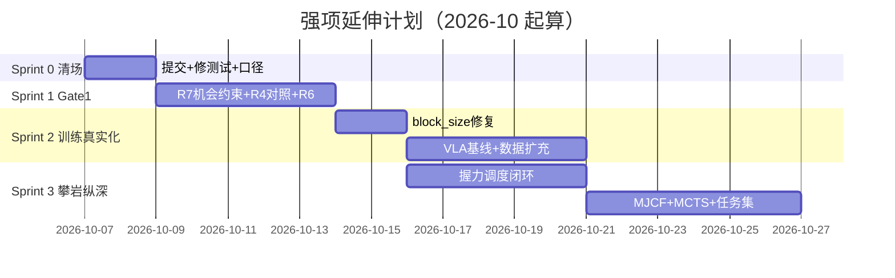

# 强项延伸下一步计划 (Strengths-Driven Next-Step Plan)

> **日期**: 2026-10-07
> **依据**: [全项能力评估记录.md](全项能力评估记录.md)（本次实测评估）+ [docs/11-production-upgrade-roadmap.md](docs/11-production-upgrade-roadmap.md) + [docs/12-capability-fit-review.md](docs/12-capability-fit-review.md)
> **策略**: 不铺新摊子。沿三条已被实测证实的强项纵深推进, 用它们反哺最痛的缺口; 硬件阻塞项（Phase P）一律不排期。
> **总目标**: 2-4 周内达成 **Gate 1（可复现的工程原型）**, 随后以攀岩闭环为载体冲击 **Gate 2（契约自洽的仿真平台）**。

---

## 一、强项清单（评估实测排序）

| # | 强项 | 实测证据 | 延伸价值 |
|---|---|---|---|
| 1 | **验收工程化与诚实审计体系** | verify 21/21、pytest 257/258、CI 3.10-3.13×双平台+aarch64、差距分析 9 份+路线图绑定文件:行号证据 | 把每个新能力都变成"退出码即结论"的可验收项, 防止能力腐烂 |
| 2 | **纯 numpy 可验证物理/算法核心** | Hertz/Hunt-Crossley/SOC/EKF、XPBD、LIPM 解析解、FOC/SVPWM 伏秒平衡 5e-15、BC/PPO/SAC/DDPM 全部带量化验收 | 零重依赖=任何机器可复现, 是整个验证体系能成立的地基 |
| 3 | **攀岩垂直场景仿真闭环** | climb_scene 全链贯通: 墙面→灵巧手→柔性指尖→VSA→dyno→能量调度→续攀, 六状态全转移, 无 mock 物理量 | 它是把 13 个离散模块焊成系统的唯一自然场景, 也是后续所有训练数据的来源 |

次级强项: 契约先行（contracts/ 四件套机器可校验）、文档体系（39 份/15,849 行）、torch 训练管线已出真实检查点。

---

## 二、Sprint 0 — 清场（立即, ≤2 天）

> 准入条件: 无。这是把 1129 行未提交工作和已知小缺陷清掉, 让后续每个 sprint 从全绿出发。

| ID | 任务 | 验收 | 量级 |
|---|---|---|---|
| S0.1 | **提交当前工作区**（Phase R 修复 + Phase A 闭环 + B1 spec profile, 23 文件 +1129 行） | `git status` 干净; 提交前 verify + pytest 全绿记录在提交信息 | 0.5h |
| S0.2 | **修复失败测试** `test_cli_exit_nonzero_on_broken_contract` — 根因已诊断（editable install 使"剥 PYTHONPATH"前提失效）, 改为注入残缺契约目录触发失败路径 | pytest 258/258; 测试不再依赖"包未安装" | 1-2h |
| S0.3 | **README 口径修正**: verify 项数 20→21; 同步"下一步行动"表格中已完成的 ✅ 项 | README 与 verify 输出零漂移 | 0.5h |

---

## 三、Sprint 1 — Gate 1 收官（本周）

> 准入: Sprint 0 完成。准出: **verify 21/21 + pytest 全绿 + 生产判据 G1 达成**。

| ID | 任务 | 对应缺口 | 验收 | 量级 |
|---|---|---|---|---|
| S1.1 | **R7 机会约束握力修复**（安全相关, 优先级最高）: 补 numpy 导入; z 值改 `statistics.NormalDist().inv_cdf(1-δ)`; `denom≤0.05` 抛 `InfeasibleGripError`; 与 `safety_budget.yaml` 的 z 口径对齐; `grip_demo` 纳入 verification.py | 评估 §6.1-2 | δ=0.001 得 3.09±0.01; 不可行输入必抛异常; verify 新增绿项 | 0.5d |
| S1.2 | **R4 收尾: 独立参考编码器对照测试** — 在测试内按 `joint_control.dbc` 位域**独立重新实现**一套编码器（不 import 被测代码）, 喂边界值/随机帧断言解码一致; 同步补 6 关节全量遥测循环（DBC 补 ID 或节点偏移复用） | G3 | 1000 帧随机对照 0 失配; 6 关节遥测各有独立断言 | 1d |
| S1.3 | **R6 残留**: `adapters/edalab.py:69-73` gradle 缓存绝对路径改环境变量覆盖 + 缺失显式 skip; stdlib 统一单版本 | G1（干净 clone 可复现） | 临时 clone + 清洁环境跑 verify 全绿 | 0.5d |
| S1.4 | **R8 决策上会**: EdaLab `git init` + `.gitignore` + jar 出索引 — **需用户拍板**, AI 只准备脚本不执行 | G5 | 决策记录一条; 若批准则当天完成 | 决策 0.5h / 执行 1h |

**Gate 1 达成声明模板**: "任意干净 clone 上 verify 21/21 + pytest 全绿, 安全数值诚实标注 assumed, CAN 编解码有独立对照测试守护。"

---

## 四、Sprint 2 — 训练管线真实化（第 2 周, 强项 ②×强项 ①）

> 准入: Gate 1。核心思路: torch 2.14 已装、检查点管线已通、verify 警告已把问题暴露——现在把"能训"升级为"训得对、训得有记录"。

| ID | 任务 | 对应缺口 | 验收 | 量级 |
|---|---|---|---|---|
| S2.1 | **C1: VLA block_size 修复** — 消除四个档位的 58% 视觉截断（提升 block_size 或降 num_views/img_size, 按 Jetson 预算反推）; 把该告警升级为 verify 硬检查项 | 评估 §6.1-1（当前最高优先软件缺陷） | verify 运行零 UserWarning; 新增检查项"min_block_size ≤ block_size" | 1d |
| S2.2 | **首个带完整记录的 VLA 训练基线** — 用修复后配置 + d4 数据跑 3 组种子, 产出 loss 曲线/成功率/检查点哈希的 Markdown 训练报告（含 provenance: 数据版本+代码 commit+超参快照） | 评估 §3.14 | 报告入 `docs/` 或 `experiments/`; 三种子曲线可复现 | 1-2d |
| S2.3 | **仿真专家 rollout 扩充 D4** — 用攀岩闭环（强项 ③）当数据引擎: climb_scene 大规模 rollout 把 120 条扩到 ≥1000 episodes, rgb/lang 用程序化生成并如实标注 synthetic | 数据域 C+ 是最短板, 但攀岩闭环让它可自助 | 新数据过 `validate_bc_dataset`; provenance 全量真实 | 2d |
| S2.4 | **C2: 训练目标/单位审计** — 对照 audit 清单逐项核对 reward/goal/DR 的真值与单位 | G4 训练层 | 审计表 + 修复项全部带测试 | 1d |

---

## 五、Sprint 3 — 攀岩闭环纵深（第 3-4 周, 强项 ③ 延伸）

> 准入: Sprint 2 的 S2.1（block_size）完成即可并行启动。准出: Gate 2 主体达成。

| ID | 任务 | 说明 | 验收 | 量级 |
|---|---|---|---|---|
| S3.1 | **L4: 触觉→握力调度闭环**（R7 是前置）— 把 EKF 滑脱前兆 → 机会约束握力 → 20Hz 控制器接线, 在攀岩捕获场景里端到端跑通 | 这是把"触觉无源"先解决为"触觉仿真有源"（用攀岩接触力当合成触觉源, 如实标注） | 捕获场景中握力随 μ 不确定性自适应收缩; 全链有测试 | 3-4d |
| S3.2 | **L1: MJCF 攀岩场景** — MuJoCo 墙面+岩点+接触参数场景, 全部物理参数带 `待实测标定` 标记 + 单调性自检 | 需先 `pip install mujoco`（本机当前未装, CI 用 reference 兜底）; 物理正确性留领域验证口 | MJCF 场景可 step 1000 帧不炸; 参数标记 100% | 2-3d |
| S3.3 | **L3: MCTS 真实化** — 决策层接真实攀岩目标（hold 图谱路径为目标函数）, 替换空转 goal | G4"决策空转" | MCTS 规划的 hold 序列被下游真实消费; 对比随机规划有显著提升 | 2d |
| S3.4 | **L6: 灵巧手攀岩任务集框架** — crimp/jug/sidepull 任务集骨架 + 参数占位 + `待领域验证` 标记（指力/腱摩擦必须由攀岩者/工程师填入, AI 不臆造） | 评审已明确此边界 | 框架可运行（用占位参数）; 每个参数有领域验证标记 | 1-2d |

---

## 六、并行 / 决策 / 明确不做

**需用户决策（本周内给答复即可）**
1. R8: EdaLab 是否 git init（涉及已入库 jar 的处理方式）
2. S2.2/S2.3 的训练机: 本机 CUDA 可用（torch 2.14+cu130 已确认）, 是否允许长时训练占用
3. 对外口径: 是否采纳"Gate 1 边缘"的对外表述

**明确不做（防散焦）**
- Phase P 全部 8 项（硬件阻塞, 接口已备, 到货当天可接）
- NeRF/VQ/async MCTS（降级清单已认同）
- 任何"可上真机"时间表承诺（Gate 3 前禁止）
- 跨三端 DR 命名统一（C4）的 AI 单方改动——只出映射表与一致性测试, 人工统一提交

**每个 Sprint 的通用验收铁律**
- 准入与准出都以 `verify` 21/21 + `pytest` 全绿为门槛
- 新能力必须落 verify 检查项（沿强项 ① 的路径: 退出码即结论）
- 所有新物理参数标注 provenance: `measured` / `assumed` / `synthetic` / `待领域验证` 四选一

---

## 七、里程碑时间线

**出口状态预期（4 周后）**: Gate 1 ✅ + Gate 2 主体 ✅; 攀岩闭环具备"感知(合成触觉)→决策(MCTS)→控制(20Hz 握力调度)→训练(D4 千级数据+VLA 基线)"的完整软件闭环; 与硬件的接口保持 v0.7 承诺的"到货当天可测"。
