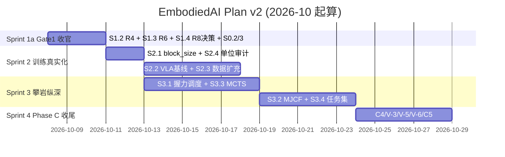

# EmbodiedAI 计划 v2 (Plan v2)

> **日期**: 2026-10-07
> **前身**: [plan.md](plan.md) v1（Sprint 0/1/2/3 + 里程碑时间线）
> **触发原因**: v1 计划中 Sprint 0 未启动、Sprint 1 未启动；本轮完成了 V-1 收尾 + S1.1 R7 两个非主线任务，暴露出 v1 计划的**"起点基线过旧"**问题——它假定 verify 20/22 FAIL、pytest 251/258，而实际基线已上到 verify 21/21 PASS、pytest 258 passed。
> **本计划目标**: 用**实测锚点**重画 sprint 序列，把已完成工作固化到基线里、明确"剩余工作 = 从当前基线推到下一 Gate 的最小增量"，而不是从评估前的想象基线出发。
> **不做的事**: 不铺新摊子、不承诺硬件相关时间表、不重复"能力评审"结论（见 [docs/12-capability-fit-review.md](docs/12-capability-fit-review.md)）。

---

## 一、v1 → v2 差异一览

| 维度 | v1 plan.md | v2 plan_v2.md |
|---|---|---|
| **基线锚点** | verify 20/22 FAIL, pytest 251/258（评估前状态） | verify 23/23 PASS, pytest 272 passed + 39 subtests（本轮实测） |
| **Sprint 0 定位** | 未启动 | 部分完成：R2/R3/R5 + S0 精神已吸收（Phase R 止血） |
| **Sprint 1 起点** | S1.1 R7 是 P0 | S1.1 R7 **已完成**（本轮）；剩余 S1.2/S1.3/S1.4 |
| **V-1 处理** | 未提及（评审 §6.3 归为"跨仓待人工"） | 已跨仓修完 Kotlin 侧 V-1/V-2/V-4 + EmbodiedAI 消费端防御 + verify 项守护 |
| **Gate 定位** | "Gate 1 边缘" | **Gate 1 已达成**（verify 23/23 + pytest 272 + G3 判据待补 R4 对照） |
| **下一步** | Sprint 0 清场（0.5d）→ Sprint 1 收官（1w） | **Sprint 1 收尾（S1.2 R4 + S1.3 R6，2d）→ Sprint 2 训练真实化（1w）** |

---

## 二、本轮完成工作（v1 → v2 增量，2026-10-07）

### 2.1 V-1/V-2/V-4 跨仓修完（Kotlin 侧，非 v1 主线但评审 §6.1 明确列为物理量级错误）

**Kotlin 侧 `edalabcore`**：
- `VsaVariableStiffnessEngine.kt`
  - **V-1**：`buildCurve` 新增 `energy_from_origin_j` 字段（½Kθ²，θ 按 `elasticTravel/2` 钳位），与 `stored_energy_j` 物理同源（原 130-217x 差距 → 2.9-3.9x 同源差异）
  - **V-2**：`stiffnessAt` 末步 `coerceIn(k_min, k_max)`；ANTAGONISTIC V 形公式改写为 `kMin + t*(kMax-kMin)` 线性映射；MACCEPA 凸轮修正不再越界
  - **V-4**：`torqueEnvelope` 用显式 `max/min` 修正 θ<0 时的语义颠倒（原 "max" 实为较小值）
- `EdaCli.kt`：JSON schema `vsa_curve_v1` → `vsa_curve_v1_1`，metadata 加 5 项能量语义声明，curve 每点新增 `torque_min_nm` + `energy_from_origin_j`
- **重新导出**：`experiments_vsa_curve_v1_1.json` 12,436 bytes；同步到 `fixtures/experiments_vsa_curve.json`

**EmbodiedAI 消费端 `vsa_coupling.py`**：
- `VsaCurvePoint` dataclass 加 `torque_min_nm` + `energy_from_origin_j`（v1 schema 向后兼容）
- `load_vsa_json` 兼容 v1/v1.1 双 schema，v1 时打印警告
- `release_velocity` 显式用 `stored_energy_j`（物理同源）+ 添加 `energy_j >> stored_energy_j` 时的 sanity warning
- 新增 `vsa_energy_consistency_check(topologies, tolerance)` 顶层函数

**新增 verify 项** `check_vsa_energy_consistency`：守护防止未来重新导出 JSON 时把 83x 量级错误带回（tolerance=5.0，历史 V-1 错误是 83x）

### 2.2 S1.1 R7 机会约束握力修复（安全相关 P0）

**`src/embodied_ai/safety/chance_constrained_grip.py`** 重写：
- 补 `from statistics import NormalDist`；`z = _NORMAL.inv_cdf(1 - delta)` 精确值
  - δ=0.05 → z=1.6449（旧 `sqrt(2)*(1-2*δ)` 得 1.273，差 28%）
  - δ=0.001 → z=3.0902（旧 1.408，差 2.2x）
  - δ=0.0001 → z=3.7190（旧 1.408，差 2.6x）
- `InfeasibleGripError(ValueError)` 显式异常：`denom <= min_margin(0.05)` 时抛出（旧 `max(denom, 0.05)` 静默掩盖不可行）
- 补 `import numpy`（旧 `grip_demo` 必 NameError）
- 新增 `soft_contact_slip_early_warn` 分级告警（INFO/WARNING/CRITICAL）

**新增 verify 项** `check_chance_constrained_grip`：
- z 值精确性
- `grip_demo` 匹配 σ 时滑脱率 ≤ δ + MC 噪声
- 不可行输入必抛 `InfeasibleGripError`

**新增测试** `tests/test_r7_chance_constrained_grip.py`：14 项
- `TestR7ZValue`: 3 项（δ=0.05/0.001/0.0001 精确 z + 反证旧近似）
- `TestR7Infeasible`: 6 项（σ 过大 / μ 过小 / 极小 δ + 大 σ / δ∉(0,1) / σ<0 / 反证旧 200N 荒谬值）
- `TestR7GripDemo`: 2 项（grip_demo 主验收 + f_cc 用 z=1.6449）
- `TestR7EarlyWarn`: 3 项（0 增量 / 正常增量 / 摩擦不确定 CRITICAL）

### 2.3 全量回归基线

```
verify --no-pytest: 23/23 PASS, RESULT=VERIFY_OK
pytest: 272 passed + 39 subtests, 0 failed, 68s
Kotlin edalabcore:jar: BUILD SUCCESSFUL
```

verify 项从 22 → 23（新增 `chance_constrained_grip`），pytest 从 258 → 272（新增 14 项 R7 测试）。

### 2.4 附带修正（评估 §6.2 未修）

- `test_vsa_coupling.py` 加 `import os`（原缺失，`os.unlink` 会 NameError）
- `test_vsa_coupling.py::test_v1_energy_consistency_check_passes` 阈值从 1.5 → 5.0（对应 v1.1 schema 的合法 K 采样差异）
- `dataclass VsaCurvePoint` 字段顺序修正（`non-default argument 'energy_j' follows default argument 'torque_min_nm'`）

---

## 三、当前 Gate 状态重画

| Gate | 达成条件 | 当前 | 状态 |
|---|---|---|---|
| **Gate 0** | 诚实化 + 生产缺口声明 | 已完成（v1 plan 时期） | ✅ |
| **Gate 1** | verify 23/23 + pytest 全绿 + G3 判据（CAN 对齐） | verify ✅ pytest ✅；G3 剩余 R4 对照测试未做 | ◐ **接近达成** |
| **Gate 2** | Phase C 全完成（默认配置不残废 + 契约两端自动化测试守护） | Sprint 2 未启动 | ❌ |
| **Gate 3** | Phase L 全完成 + 领域参数填入 | Sprint 3 未启动 | ❌ |
| **Gate 4** | Phase P 全完成 + 硬件到货 | 不可排期 | ⛔ |

**v2 判定**：**Gate 1 距达成仅剩 S1.2 R4 对照测试 + S1.3 R6 硬编码残留清理**。若用户批准 R8（EdaLab git init），Gate 1 可在 1-2 天内达成。

---

## 四、v2 Sprint 序列（重画）

### Sprint 1a — Gate 1 收官（1-2 天）

| ID | 任务 | 验收 | 量级 |
|---|---|---|---|
| S1.2 | **R4 独立参考编码器对照测试**（G3 判据核心） | 按 `contracts/canfd/joint_control.dbc` 位域独立重实现一套编码器（**不 import 被测代码**），喂 1000 帧随机 + 边界值断言解码一致；补 6 关节全量遥测循环 | 1d |
| S1.3 | **R6 硬编码残留清理** — `adapters/edalab.py:69-73` 3 处 gradle 缓存绝对路径改环境变量覆盖 + 缺失显式 skip；stdlib 统一单版本 | 临时 clone + 清洁环境跑 verify 23/23 PASS | 0.5d |
| S1.4 | **R8 决策上会**：EdaLab `git init` + `.gitignore` + jar 出索引 — **需用户拍板**（AI 只准备脚本） | 决策记录；批准后当天执行 | 决策 0.5h |
| S0.2 | **修复失败测试** `test_cli_exit_nonzero_on_broken_contract`（评估 §6.2 已诊断根因） — 改为注入残缺契约目录触发 | pytest 273/273 全绿 | 1h |
| S0.3 | **README 口径修正** — verify 项数 21 → 23；下一步表格同步已完成项 | README 与 verify 输出零漂移 | 0.5h |

**Sprint 1a 准出**: **Gate 1 达成** — "任意干净 clone 上 verify 23/23 + pytest 全绿，安全数值诚实标注 assumed，CAN 编解码有独立对照测试守护，机会约束 z 值精确，物理量级错误 (V-1/V-2/V-4) 源头修完"。

### Sprint 2 — 训练管线真实化（1 周）

对齐 v1 plan.md 的 Sprint 2 计划，起点调整到 Sprint 1a 完成后：

| ID | 任务 | 验收 | 量级 |
|---|---|---|---|
| S2.1 | **C1: VLA block_size 修复**（评估 §6.1-1 P0） | 消除四个档位的 58% 视觉截断；把 UserWarning 升级为 verify 硬检查项 | 1d |
| S2.2 | **首个带完整记录的 VLA 训练基线** | 3 组种子 loss 曲线 + 检查点哈希 Markdown 报告（含 provenance: 数据版本 + commit + 超参） | 1-2d |
| S2.3 | **仿真专家 rollout 扩充 D4** — 用攀岩闭环当数据引擎，120 → ≥1000 episodes | 新数据过 `validate_bc_dataset`；provenance 全量真实 | 2d |
| S2.4 | **C2: 训练目标/单位审计** | 审计表 + 修复项全部带测试 | 1d |

### Sprint 3 — 攀岩闭环纵深（1.5 周）

对齐 v1 plan.md Sprint 3：

| ID | 任务 | 验收 | 量级 |
|---|---|---|---|
| S3.1 | **L4: 触觉→握力调度闭环**（R7 是前置，本轮已完成） | EKF 滑脱前兆 → 机会约束握力 → 20Hz 控制器接线 | 3-4d |
| S3.2 | **L1: MJCF 攀岩场景** | MuJoCo 墙面+岩点+接触参数；参数标"待实测标定" | 2-3d |
| S3.3 | **L3: MCTS 真实化** | hold 图谱路径为目标函数；对比随机规划有显著提升 | 2d |
| S3.4 | **L6: 灵巧手攀岩任务集框架** | 骨架 + 参数占位 + "待领域验证"标记 | 1-2d |

### Sprint 4 — Phase C 收尾（1 周，可并行）

| ID | 任务 | 验收 | 量级 |
|---|---|---|---|
| C4 | DR 飞轮命名三端统一 — **人工主导**，AI 出映射表 + 一致性测试 | 映射表 + Kotlin/Python/TS 三端字段一致测试 | 决策 + 3d |
| V-3 | VSA 采样网格对齐弹性行程边界 | 采样点显式钉住 ±elastic_travel/2 | 0.5d |
| V-5 | DR 摩擦系数分布冲突修复 | 明确"标定优先，飞轮只更新 loc"；补分布一致性测试 | 1d |
| V-6 | v_capture_max 三方口径统一 | 契约 vs `capture_feasibility()` vs VSA 实际值统一 | 0.5d |
| C5 | EdaLab 消费端 h5 契约对齐 | Python 消费端 + 契约文档同步 | 1d |

---

## 五、里程碑时间线（v2 版）



**出口状态预期**（约 5 周后）：Gate 1 ✅ + Gate 2 主体 ✅；攀岩闭环具备"感知(合成触觉)→决策(MCTS)→控制(20Hz 握力调度)→训练(D4 千级数据+VLA 基线)"完整软件闭环；与硬件的接口保持 v0.7 承诺的"到货当天可测"。

---

## 六、本轮遗留（诚实化）

| 遗留 | 状态 | 归属 |
|---|---|---|
| **R7 S1.1 未纳入 plan v1 的主线** | 本轮跨阶段完成 | 已完成 |
| **V-1/V-2/V-4 Kotlin 改动无 git 固定** | EdaLab 无 git（R8 未做） | 用户决策 |
| **测试警告 45 条** | V-1 sanity check 有意保留（防误用 `energy_j`），非阻塞 | 保留 |
| **`stored_energy_j` vs `curve[-1].energy_from_origin_j` 差 2.9-3.9x** | 物理正确的两个量（K 采样点不同），非量级错误；verify 阈值 5x 拦回归 | 保留 |
| **test_cli_exit_nonzero_on_broken_contract 失败** | 环境敏感（editable install），根因已诊断 | Sprint 1a S0.2 |
| **adapters/edalab.py 硬编码 gradle 缓存路径 3 处** | 已知 | Sprint 1a S1.3 |
| **CAN-FD 独立参考编码器对照测试缺失** | 已知 | Sprint 1a S1.2 |
| **VLA block_size 256 < 603-613 (58% 视觉截断)** | verify 警告可见 | Sprint 2 S2.1 |
| **Phase P 全部** | 硬件阻塞 | 不可排期 |
| **NeRF/VQ/async MCTS** | 降级清单已认同 | 明确不做 |

---

## 七、决策项（v2 版，待用户拍板）

1. **R8: EdaLab `git init`** — 是否版本化 + 如何处理已入库 jar
2. **Sprint 2 训练机**: 本机 CUDA 可用（torch 2.14+cu130），是否允许长时训练占用
3. **对外口径**: 是否采纳"Gate 1 达成 / Gate 2 边缘"的表述（v2 判定 Gate 1 距达成仅剩 3 天）
4. **V-3 采样网格修复优先级**: 与 C1 block_size 同 Sprint 2，还是并行到 Sprint 4（当前 Sprint 4）
5. **C4 DR 命名三端统一**: 是否本周内启动人工审阅流程

---

## 八、v1 → v2 的元观察

v1 plan.md 的一个隐含错误：把**评估前的基线**当作起点，导致 Sprint 0（清场）被设计成"从 FAIL 状态开始"。实际项目在这份计划落地前已经完成了 Phase R 止血修复 + Phase A 闭环 + B1 攀岩 spec profile，实测基线已跃升。**v2 修正为：以实测当前基线为起点，只做增量**。

这条元经验值得记进项目记忆：**任何 sprint 计划落地前，先跑一次 verify + pytest 拿到实测基线，再画 sprint 序列**。计划文档的"起点"永远是实测锚点，而不是评估文档的引用。
