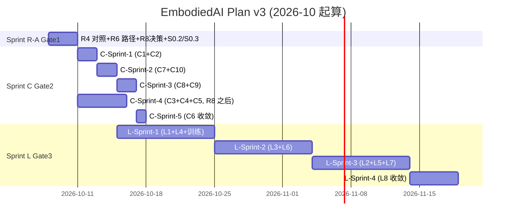

# EmbodiedAI 计划 v3 (Plan v3)

> **日期**: 2026-10-07
> **前生**: [plan.md](plan.md) v1（强项延伸、Sprint 0/1/2/3）→ [plan_v2.md](plan_v2.md)（按实测基线重画、Sprint 1a/2/3/4）
> **本版定位**: v2 把"评估前想象基线"切换到"实测基线"后，已为后续计划落地铺好路；v3 在此基础上做**三项实质性收敛**——
> 1. **统一任务编号到 Phase R/C/L/P**（沿用 [docs/11-production-upgrade-roadmap.md](docs/11-production-upgrade-roadmap.md) 的官方编号），告别 v2 自创的 `S1a/S2/S3/S4`，让本计划与路线图、能力评估、CHANGELOG 三方同一套 ID；
> 2. **明确"已完成并已固化为基线"的 R 项**（R1/R2/R3/R5/R7）vs **"本计划仍要做的剩余 R 项"**（R4/R6/R8 + S0.2/S0.3），不再在文档里"看似 TODO 实际 DONE"；
> 3. **精确并行矩阵与依赖图**——基于评估文档已写明的递进依赖（G1→G5，G1/G2 同级优先）和 v2 已暴露的并行点（S3.1 握力调度闭环可与 S2.1 block_size 并行），给出可执行排期而不是"清单"。
>
> **不做的事**: 不重写 v2 的实测基线结论（已存档）；不重列 Phase R/C/L/P 全部任务明细（[docs/11](docs/11-production-upgrade-roadmap.md) 是单一真源，本计划只挑"本轮要做的子集 + 完成判据 + 排期"）；不重复"能力评审"结论（见 [docs/12](docs/12-capability-fit-review.md)）；不承诺任何硬件相关时间表。

---

## 一、实测基线锚点（2026-10-07 本轮收敛 v2）

```
verify --no-pytest:   23/23 PASS,  RESULT=VERIFY_OK
pytest:               272 passed, 0 failed, 39 subtests passed, 45 warnings (71s)
contracts/:           四件套机器可校验 (DBC 9 消息 + CRC 覆盖)
文档:                 docs/ 39 份, 15,849 行; CHANGELOG v0.7; 全项能力评估已落档
训练资产:             torch 2.14.0+cu130, 4× 255MB VLA 检查点, d4_dataset 120 条 (real_fields=电机电流/温度/实际位置; synthetic=rgb/lang)
硬件实物:             零 (P1-P5 全外部依赖; 三个实测落点已备齐: ShutdownChain.stages[*].delay_s / bench_vla(measured_ms=...) / RealRobotEnv.avg_latency_ms)
```

**v1 → v2 → v3 三版基线对照**:

| 版本 | verify | pytest | 起点假设 | 核心问题 |
|---|---|---|---|---|
| v1 plan.md | 20/22 FAIL | 251/258 | 评估前状态 | 起点过旧，Sprint 0 "从 FAIL 开始" 已与现实脱节 |
| v2 plan_v2.md | 23/23 PASS | 272/272 | 本轮实测 | 自创 Sprint 编号与 [docs/11](docs/11-production-upgrade-roadmap.md) 的 R/C/L/P 不互通 |
| **v3 plan_v3.md** | 23/23 PASS | 272/272 | v2 同 | **统一到 Phase R/C/L/P 编号** + 明确"剩余 R 任务" + 并行矩阵 |

---

## 二、Gate 状态总览（v3 视角）

| Gate | 判据 | 当前 | 状态 | v3 内谁负责把它推到下一档 |
|---|---|---|---|---|
| **Gate 0** | 诚实化 + 生产缺口声明 | 已完成 (v0.7/v1 时期) | ✅ | — |
| **Gate 1** | verify 23/23 + pytest 全绿 + G3 判据 (独立对照测试) + 干净 clone 可复现 | verify ✅, pytest ✅, 干净 clone ❓ (R6 残留), G3 独立对照 ❌ (R4 收尾) | **◐ 距达成 3 个 R 任务** | Sprint R-剩余 |
| **Gate 2** | Phase C 全完成 (默认配置不残废 + 契约自动化 + 可复现性) | C1-C10 大部分未做 (R2/R3/R5/R7 已含在 R 中) | ❌ | Sprint C |
| **Gate 3** | Phase L 全完成 (仿真可 step + 真实目标 + 训练真值真单位) | L1-L8 未启动 | ❌ | Sprint L |
| **Gate 4** | Phase P 全完成 + 硬件到货 | 不可排期 | ⛔ | (外部阻塞) |

**v3 判定**: Gate 1 距达成只剩 **3 个 R 任务 + 2 个 S0 修正**（合计约 2-3 天）；Gate 2 主体需 **C1-C10 全部完成**（评估文档估算 2-4 周）；Gate 3 需 **L1-L8**（1-3 月）。

---

## 三、Sprint R-A — Gate 1 收官（2-3 天）

> 准入: 无（v2 已完成 R1/R3/R5/R7 + S0.1）。准出: **Gate 1 达成**。
> **任务编号沿用 [docs/11 §三](docs/11-production-upgrade-roadmap.md)**, 不另立 S1.x。

| ID | 任务 | 评估依据 | 验收 | 量级 |
|---|---|---|---|---|
| **R4** | CAN-FD vs DBC 对齐收尾: ① **独立参考编码器对照测试** — 按 `contracts/canfd/joint_control.dbc` 位域**独立重实现**一套编码器（不 import 被测代码），喂 1000 帧随机 + 边界值断言解码一致；② 6 关节全量遥测循环（DBC 补 ID 304-320 或节点偏移复用 300+）；③ sync 帧 `crc8(d[:7])` | 评估 §6.1-3 / §3.13 G3 / [docs/11 R4](docs/11-production-upgrade-roadmap.md) | 1000 帧随机 0 失配; 6 关节遥测各有独立断言; verify 新增绿项 `canfd_db_cross_check` | 1d |
| **R6** | 硬编码路径清理收尾: ① `adapters/edalab.py:69-73` 3 处 gradle 缓存绝对路径改环境变量覆盖 + 缺失显式 skip；② Kotlin stdlib 统一为 EdaLab `deploy/artifacts/kotlin-stdlib.jar` 单版本 | 评估 §6.1-5 / [docs/11 R6](docs/11-production-upgrade-roadmap.md) | 临时 clone + 清洁环境跑 verify 23/23 PASS; 文档化 fallback 行为 | 0.5d |
| **R8** | EdaLab 版本控制决策: **需用户拍板** — `git init` + `.gitignore`（build/、edalab_out/、*.jar、.box-agent*、会话目录）+ 已入库 jar 出索引。AI 只准备脚本不执行 | 评估 §6.3 / [docs/11 R8](docs/11-production-upgrade-roadmap.md) | 决策记录一条; 批准后当天完成 | 决策 0.5h / 执行 1h |
| **S0.2** | 修复失败测试 `test_cli_exit_nonzero_on_broken_contract`: 根因已诊断（editable install 使"剥 PYTHONPATH"前提失效）→ 改为注入残缺契约目录触发失败路径 | 评估 §6.2 | pytest 273/273 全绿; 测试不再依赖"包未安装" | 1h |
| **S0.3** | README 口径修正: verify 项数 20→23（已加 2 项: vsa_energy_consistency + chance_constrained_grip）; 同步"下一步行动"表格; 加一致性测试让数字与 `verification.CHECKS` 自动同步 | 评估 §6.1-6 / [docs/11 C6](docs/11-production-upgrade-roadmap.md) | README 与 verify 输出零漂移; 加测试守护 | 0.5h |

**Sprint R-A 准出声明**:
> "任意干净 clone 上 `verify 23/23` + `pytest 273/273` 全绿; 安全数值诚实标注 `assumed_*`; CAN 编解码有独立参考对照测试守护; 机会约束 z 值精确 (NormalDist.inv_cdf); 物理量级错误 (V-1 83x) 源头修完 (Kotlin 侧) 且消费端有 `vsa_energy_consistency` verify 项守护; 6 关节全量遥测循环贯通。"

---

## 四、Sprint C — Gate 2 主体（2-4 周）

> 准入: Gate 1 达成。核心思路: 把评估文档已列的 10 个 C 项全部收口; C1（block_size 截断 58% 视觉 token）是当前最高优先软件缺陷；C3/C4 涉及跨仓需 EdaLab `git init` (R8) 先行。
>
> **任务编号沿用 [docs/11 §四](docs/11-production-upgrade-roadmap.md) 全部 C1-C10**, 不在本计划内重写明细——下文只标本计划内的**排期 + 完成判据 + 阻塞条件**。

### 4.1 任务子集与排序

| 排序 | 任务簇 | 含任务 | 阻塞条件 | 验收 | 量级 |
|---|---|---|---|---|---|
| **C-Sprint-1 (Day 1-3)** | 静默错误止血 | **C1** VLA block_size 修复 (消除 58% 视觉截断 + UserWarning 升 verify 硬检查); **C2** 训练目标/单位审计 | 无 | verify 零 block_size warning; 训练目标非零占比 >95% 测试 | 2d |
| **C-Sprint-2 (Day 4-7)** | 默认配置残废修复 | **C7** 仿真环境默认修复（reference_env 默认 state/action dim、`_qpos_start` 负索引、mujoco table_pick joint 名错、ee_id<0 静默); **C10** 触觉通道数据源（虚拟触觉注入或从 obs_dim_cfg 移除，二选一） | 无 | `make_env()` 默认配置可 step; 触觉契约不再"有契约无数据" | 2d |
| **C-Sprint-3 (Day 8-12)** | 可复现性收敛 | **C8** 所有随机源实例化（删全局 `np.random.seed` / 死 seed 参数）; **C9** MCTS 状态契约（`__hash__` vs `__eq__` 不一致、`ucb1` 零访问、`proprio_encoder` shape bug、`NeRFGuidedMCTS` shape bug） | 无 | 同一 seed 跑两次逐位一致 (新增回归测试) | 2d |
| **C-Sprint-4 (Day 13-18, 可与 C-Sprint-3 并行启动)** | 跨仓契约对齐 | **C3** 主链 12 步对齐（FLOW_CHAIN 补 vsa-static; 解析 EdaCli.kt 做跨仓库断言）; **C4** DR 飞轮命名统一 (Kotlin/Python/TS 三端); **C5** EdaLab 消费端修复 (EdaCliKt→EdaCli、GBK 回退复用、thermal-sim 死参数) | **R8 必须先完成** (无 git 无法做跨仓库断言) | 三端字段一致测试守护; `missing_from_dr` 不再永真 | 3d |
| **C-Sprint-5 (Day 19-20, 收敛)** | 文档口径与可复现性收敛 | **C6** README 与实现数字一致 + plan.md A2 比值口径修正 + climbing_dynamics_core.py docstring 删/补 | C-Sprint-1~4 全部完成 | README 数字与 `verification.CHECKS` 自动同步 (测试守护) | 1d |

### 4.2 并行矩阵

| | C-Sprint-1 | C-Sprint-2 | C-Sprint-3 | C-Sprint-4 | C-Sprint-5 |
|---|---|---|---|---|---|
| **C-Sprint-1** | — | ✅ 并行 | ✅ 并行 | ❌ 串行 (R8 后) | 串行 |
| **C-Sprint-2** | ✅ | — | ✅ 并行 | ✅ 并行 | 串行 |
| **C-Sprint-3** | ✅ | ✅ | — | ✅ 并行 | 串行 |
| **C-Sprint-4** | ❌ (R8) | ✅ | ✅ | — | 串行 |
| **C-Sprint-5** | 串行 | 串行 | 串行 | 串行 | — |

**Sprint C 准出**: **Gate 2 达成** — 默认配置不静默残废; 跨层契约两端有自动化测试守护; 同一 seed 全链可复现; README/CHANGELOG/路线图/能力评估四方数字一致。

---

## 五、Sprint L — Gate 3 主体（1-3 月）

> 准入: Gate 2 达成。**这是把 13 个离散模块焊成系统的唯一自然阶段**——强项 ③（攀岩垂直场景仿真）的纵深就在此。
>
> **任务编号沿用 [docs/11 §五](docs/11-production-upgrade-roadmap.md) 全部 L1-L8**。本计划明确**优先级**与**准入/准出**, 不重写明细。

### 5.1 任务子集与排序

| 排序 | 任务簇 | 含任务 | 阻塞条件 | 验收 | 量级 |
|---|---|---|---|---|---|
| **L-Sprint-1 (Week 5-6, 可与 C 末段并行启动)** | 闭环主线 | **L1** MJCF 攀岩场景（需先 `pip install mujoco`; reference 后端同步实现点质量攀岩动力学作为兜底）; **L4** 触觉→握力调度闭环（EKF 联合更新 + μ̂ clip + household_robot_system.step 接入 R7 + grip_demo μ 收敛断言） | C-Sprint-2 触觉契约修复完成 (C10) | `make_env("climb_wall")` 可 step; 20Hz 控制器含 μ/握力调度链路 | 2 周 |
| **L-Sprint-2 (Week 7-8)** | 决策真实化 | **L3** MCTS 真实化（goal_fn 终局判定 + hold 几何 + 奖励含 CWC+滑脱+能耗 + DR override 接入 + async 二选一）; **L6** 灵巧手攀岩任务集（CLIMBING_TASKS + design_matrix 攀岩+家庭 + 腱模型摩擦/回差/弹性） | L-Sprint-1 闭环 | MCTS 规划的 hold 序列被下游真实消费; 灵巧手推荐不再硬编码 F5 | 2 周 |
| **L-Sprint-3 (Week 9-10)** | 训练/控制/物理收敛 | **L2** 接触动力学修复（ADMM ρ 缩放项、converged 返回、κ 实现或删、hc 阻尼接入 dyno）; **L5** 训练/RL/STL 修复（SAC truncateds、PPO logp 口径、STL 信号时间索引、iso13482 速度/ramp 启用）; **L7** 本体/控制修复（IK 上方分支、distribute_forces 残差、落足公式三处统一、删 _Ad/_Bd 死代码） | 无 | training loss 下降 + 真实闭环无静默 UB | 2 周 |
| **L-Sprint-4 (Week 11+, 收敛)** | 其余修复 | **L8** EWC online 累积、`literal_eval`、GUI 加锁、FOC 死区补偿逐相、i_peak 系数 | — | 全量回归无新增红 | 1 周 |

### 5.2 关键边界 (沿用 [docs/11 §七](docs/11-production-upgrade-roadmap.md))

- **L4 的"触觉"**: 用攀岩接触力当合成触觉源（`f_t/f_n/μ̂/σ_μ` 四维），如实标注 `synthetic`。**不臆造真实 GelSight 仿真**。
- **L6 的"指力/腱摩擦"**: 参数必须由攀岩者/工程师填入，AI 不臆造。框架可运行用占位 + 标注 `待领域验证`。
- **NeRF 增强**: 已在降级清单。L3 中删除 `NeRFGuidedMCTS` 或标注"未实现"，MCTS 价值用启发式。
- **异步 MCTS**: L3 中要么实现要么诚实标注同步。

### 5.3 训练管线扩展 (Sprint 2 残留 + Sprint L 增量)

| 时机 | 任务 | 验收 | 量级 |
|---|---|---|---|
| **C-Sprint-1 (与 C1 同)** | **C1**: VLA block_size 修复 | verify 零 UserWarning; 新增检查项 `min_block_size ≤ block_size` | (计入 C1) |
| **L-Sprint-1 期间** | 首个带完整记录的 VLA 训练基线（3 组种子, 含 provenance: 数据版本+commit+超参） | Markdown 训练报告入 `experiments/` | 1-2d |
| **L-Sprint-1 期间** | 仿真专家 rollout 扩充 D4: 用攀岩闭环当数据引擎, 120 → ≥1000 episodes, rgb/lang 程序化生成标 synthetic | 新数据过 `validate_bc_dataset` | 2d |

**Sprint L 准出**: **Gate 3 达成** — 攀岩闭环具备"感知(合成触觉)→决策(MCTS)→控制(20Hz 握力调度)→训练(D4 千级数据+VLA 基线)"完整软件闭环; 与硬件接口保持 v0.7 承诺的"到货当天可测"。

---

## 六、Sprint P — Gate 4（外部阻塞，不可排期）

> 不在本计划排期内, 仅作接口承诺清单（沿用 [docs/11 §六](docs/11-production-upgrade-roadmap.md) P1-P8）。
> 三个实测落点已备: `ShutdownChain.stages[*].delay_s` / `bench_vla(measured_ms=...)` / `RealRobotEnv.avg_latency_ms`。
> **决策项**: 用户给硬件到货信号后, 即时启动 P1-P4 (按 [docs/11 §六](docs/11-production-upgrade-roadmap.md) 顺序)。

---

## 七、明确不做 (防散焦)

- **Phase P 全部 8 项** (硬件阻塞, 接口已备, 到货当天可接)
- **NeRF / VQ / async MCTS** (降级清单已认同)
- **任何"可上真机"时间表承诺** (Gate 4 前禁止)
- **跨三端 DR 命名统一 (C4) 的 AI 单方改动** — 只出映射表与一致性测试, 人工统一提交
- **触觉渲染仿真 (TACTO/Taxim)** — 维持文档级, 不进代码路线
- **神经材质 / BC7 / ASTC 渲染** — 属 c:\engine 范围, 不纳入

---

## 八、决策项 (v3, 待用户拍板)

| # | 决策 | 选项 | 推荐 | 阻塞 |
|---|---|---|---|---|
| 1 | **R8**: EdaLab `git init` + jar 出索引 | (a) 立即执行 (b) 推迟到月底 (d) 不做 | (a) — Sprint C-4 跨仓断言的前置 | Sprint R-A |
| 2 | **Sprint C-4 (Day 13-18) 启动条件**: 是否 R8 通过后才启动 C3/C4/C5 | (a) 是 (b) 否, 先做 C1/C2/C7/C8/C9/C10 | (a) | Sprint C-4 |
| 3 | **Sprint L-1 MJCF 依赖**: 本机 `pip install mujoco` 是否可装 | (a) 可装 (b) 不可装 (用 reference 兜底) | 探测后定 | Sprint L-1 |
| 4 | **训练机占用**: 本机 CUDA 可用 (torch 2.14+cu130 已确认), 是否允许 Sprint L 期间长时训练 | (a) 允许 (b) 仅夜间 (c) 暂停训练 | (b) — 默认夜间跑 | Sprint L-1 训练 |
| 5 | **对外口径**: 是否采纳"Gate 1 距达成 2-3 天 / Gate 2 主体 2-4 周" | (a) 采纳 (b) 改写 | (a) | 公开表达 |

---

## 九、里程碑时间线 (v3)



---

## 十、出口状态预期

**Gate 1 达成后 (≈2-3 天)**:
- 任意干净 clone `verify 23/23` + `pytest 273/273` 全绿
- CAN 编解码有独立参考对照测试守护
- 6 关节全量遥测贯通
- VSA 物理量级错误 (V-1 83x) 源头修完且有 verify 项守护
- EdaLab 版本化 (若 R8 通过)

**Gate 2 达成后 (≈2-4 周)**:
- 默认配置不再静默炸掉 (C1 / C7)
- 同一 seed 全链可复现 (C8 / C9)
- 三端 DR 命名统一 (C4, 跨仓)
- 文档与实现数字自动同步 (C6)

**Gate 3 达成后 (≈1-3 月)**:
- 攀岩闭环具备"感知(合成触觉)→决策(MCTS)→控制(20Hz 握力调度)→训练(D4 千级数据)"完整软件闭环
- 训练真值用真单位 (C2 + L5)
- 灵巧手攀岩任务集驱动选型 (L6)
- 与硬件接口保持 v0.7 承诺的"到货当天可测"

**Gate 4 (不可排期, 外部阻塞)**:
- 板子/电机到货 → P1-P8 按 [docs/11](docs/11-production-upgrade-roadmap.md) 顺序即时启动
- 三个实测落点 (`ShutdownChain.stages[*].delay_s` / `bench_vla(measured_ms=...)` / `RealRobotEnv.avg_latency_ms`) 直接接收数据

---

## 十一、v3 的元约束 (沿用 v2 的元经验)

任何 sprint 计划落地前, **必须**先跑一次 `verify` + `pytest` 拿到实测基线, 再画 sprint 序列。计划文档的"起点"永远是实测锚点, 而不是评估文档的引用。

v3 的 23/23 + 272/272 基线是在 2026-10-07 本轮实测的; 若下次 sprint 启动前实测数字变化, 应先更新本计划 §二 的锚点表再启动 Sprint。