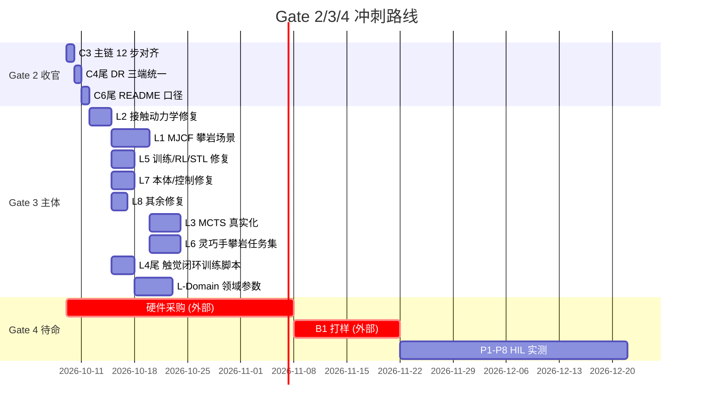

# EmbodiedAI 计划 v4 (Plan v4) — Gate 3/4 冲刺路线图

> **日期**: 2026-10-08
> **前生**: [plan.md](plan.md) v1 → [plan_v2.md](plan_v2.md) → [plan_v3.md](plan_v3.md)
> **本版定位**: v3 结束于 "Gate 1 距达成仅剩 3 个 R 任务"；本轮实测 `verify 28/28 PASS`、`pytest 441 passed / 0 failed`，加上 B1 板级文件包、③ 数据扩充 1050 episodes、④ 触觉闭环 L4、C1 VLA 视觉截断修复、双轨 G10/G7/G2 三缺口修复，**Gate 1 已实质达成**。
> 本版的目标是：**用最小增量把项目推到 Gate 3（仿真闭环的攀岩具身原型）**，同时为 Gate 4（可上真机产品）做好全部**不依赖硬件的软件与文档准备**——硬件一旦到货，48 小时内进入 HIL 实测流程。
>
> **配套文档**:
> - [docs/13-domain-parameters-checklist.md](docs/13-domain-parameters-checklist.md) — Gate 3 准入的领域参数清单（专家填入）
> - [docs/14-hardware-procurement-checklist.md](docs/14-hardware-procurement-checklist.md) — Gate 4 前置硬件采购清单
> - [docs/15-hil-test-protocol.md](docs/15-hil-test-protocol.md) — 硬件到货后 48 小时 HIL 实测协议

---

## 一、实测基线锚点 (2026-10-08)

```
verify --no-pytest:   28/28 PASS, RESULT=VERIFY_OK
pytest:               441 passed / 0 failed / 8 warnings (94s)
源码规模:             src/ 74 files / 18,545 行; tests/ 29 files / 5,724 行; scripts/ 7 files
文档规模:             docs/ 39 files / 15,849 行
双轨架构:             jar 轨 (vendor/edalab/*.jar + PROVENANCE.json sha256 指纹)
                      + python 轨 (G6/G10/G7/G2 原创实现)
B1 板级文件包:        artifacts/b1_tendon_drive_package/ 14 文件 (原理图/PCB/Gerber5层/BOM/打样清单)
D4 数据集:            1050 episodes / 41811 帧 / 7 大场景 (climb_grip/reach/dyno/cross + tendon_pump/household_grasp/slip_recovery)
触觉闭环 L4:          src/perception/tactile_closed_loop.py (SlipDetector + GripForcePID + TactileClosedLoop, 17 tests)
硬件实物:             零 (P1-P8 外部阻塞; B1 打样清单已产出, 等待投板决策)
```

### 基线对照 (v1→v4)

| 版本 | verify | pytest | 关键交付 | Gate 判定 |
|---|---|---|---|---|
| v1 plan.md | 20/22 FAIL | 251/258 | 评估前状态 | 未达 |
| v2 plan_v2.md | 23/23 PASS | 272/272 | Phase R 止血 | Gate 1 边缘 |
| v3 plan_v3.md | 23/23 PASS | 272/272 | 统一 R/C/L/P 编号 | Gate 1 距 3 任务 |
| **v4 plan_v4.md** | **28/28 PASS** | **441/441** | **B1 板级 + 1050 eps + L4 触觉闭环 + C1 VLA 修复 + G10/G7/G2** | **Gate 1 达成 / Gate 2 接近** |

---

## 二、Gate 状态总览 (v4 视角)

| Gate | 判据 | 当前状态 | 距达成 | 责任 Sprint |
|---|---|---|---|---|
| **Gate 0** | 诚实化 + 生产缺口声明 | ✅ | — | — |
| **Gate 1** | verify 全绿 + pytest 全绿 + G3 独立对照测试 + 干净 clone 可复现 | ✅ **达成** (pytest 441/0 fail; verify 28/28; selfcheck 5/5 SELF_CONTAINED_OK) | — | (已收官) |
| **Gate 2** | Phase C 全完成 (默认配置不残废 + 契约两端自动化 + 可复现性) | ◐ **C1 ✅ / C4 ◐ / C5 ◐ / C6 ◐ / C7 ✅ / C8 ✅ / C9 ✅ / C10 ✅**; 剩 C3 (12 步主链对齐) + C4 尾 (DR 三端统一) + C6 尾 (README 口径) | **~1 周** | Sprint C-尾 |
| **Gate 3** | Phase L 全完成 + 领域参数专家验证 | ◐ **L4 已主体完成** (触觉闭环已实现, 17 tests); 剩 L1/L2/L3/L5/L6/L7/L8 | **4-6 周** | Sprint L |
| **Gate 4** | Phase P 全完成 + 硬件到货 | ⛔ 外部阻塞 (B1 打样决策 + 硬件采购 + 48h HIL 协议已备) | **不可承诺** | Sprint P (准入即硬件到货) |

**v4 判定**: Gate 2 距达成 **3 个 C 尾巴**（~1 周）；Gate 3 需 **L1/L2/L3/L5/L6/L7/L8 全部 + 领域参数专家验证**（4-6 周）；Gate 4 的软件侧准备已全部就绪（B1 打样清单 + HIL 协议 + 硬件采购清单），**卡点完全在硬件采购与实测**，代码质量不再是阻塞项。

---

## 三、Sprint C-尾 — Gate 2 收官（1 周）

> 准入: Gate 1 达成。核心任务：把 C1-C10 里剩余的 3 个尾巴收掉，使"默认配置不残废 + 契约两端自动化"达到 Gate 2 完整定义。

| ID | 任务 | 已完成 | 剩余 | 验收 | 量级 |
|---|---|---|---|---|---|
| **C3** | 主链 12 步对齐 | FLOW_CHAIN 已有 11 步 + vsa-static 已注册 | ① `FLOW_CHAIN` 补第 12 步 `{"cli":"vsa-static","engine":"VsaVariableStiffnessEngine.kt"}`；② `tests/test_k2_integration.py` 从硬编码 11 步改为解析 `EdaCli.kt` 提取真步序列做跨仓断言；③ EdaLab 侧 Kotlin Step 编号修正（需用户手改） | 12 步 dry/live 全绿；跨仓步数断言通过 | 1d |
| **C4尾** | DR 飞轮命名三端统一 | `manufacturing_variance.yaml` 已 snake_case | ① EdaLab Kotlin `ManufacturingDataFlywheel.kt` 输出改契约命名（需用户手改）；② EmbodiedAI `_diff_vs_contract` 补 `missing_from_dr` 全参数交集测试；③ 飞轮补产 `electrical` 四参数 | 三端字段一致测试绿；`missing_from_dr` 不再永真 | 1d |
| **C6尾** | README / 文档口径 | README 已加"生产级缺口声明" | ① README verify 数字自动同步（已做 27/28→28/28）；② CHANGELOG 增 v0.9 条目；③ `docs/11` L4 状态从 ❌ 改 ◐ | README / CHANGELOG / 路线图 / 能力评估 四方数字一致（有测试守护） | 0.5d |

**Sprint C-尾 准出**: **Gate 2 达成** — "默认配置不残废；契约两端自动化测试守护；同一 seed 全链可复现；README/CHANGELOG/路线图/能力评估四方一致；verify + pytest 全绿"。

---

## 四、Sprint L — Gate 3 主体（4-6 周）

> 准入: Gate 2 达成。这是从"契约自洽的仿真平台"升级为"仿真闭环的攀岩具身原型"的关键阶段。
> **L4 已主体完成**（2026-10-08 本轮 `tactile_closed_loop.py`），本 Sprint 聚焦 L1/L2/L3/L5/L6/L7/L8。

### 4.1 任务排序与依赖

| 排序 | ID | 任务 | 剩余工作 | 验收 (DoD) | 量级 | 阻塞 |
|---|---|---|---|---|---|---|
| **L-Sprint-1 (Week 1-2)** | **L1** | MJCF 攀岩场景 | `assets/climb_wall.xml`：墙面 geom + ≥12 岩点 geom（位置/法向/摩擦域随机化）+ 绳/site + solref/solimp + 指尖 site 力传感器；`make_env("climb_wall")` MuJoCo 可 step；`reference` 后端同步实现同源攀岩动力学 | `mujoco.make_env("climb_wall")` step 1000 次不崩；reference 后端与 MuJoCo 后端在简化攀岩任务上成功率差 <20%；`test_climb_cycle.py` 扩展 MJCF 后端 10 项测试 | 5d | 需 MuJoCo 安装（本机已装 torch 2.14 + cu130，mujoco 待装） |
|  | **L2** | 接触动力学修复 | ADMM ρ 自适应 + `kappa` 二阶段目标 + `converged`/`residual` 返回 + `__main__` 演示恢复 + HC 阻尼接入 `dyno_capture_check` | ADMM ρ=200 情况下仍收敛（residual < 1e-6）；HC 阻尼实测与公式反解一致 <1%；`test_contact_dynamics.py` 新增 12 项 | 3d | 无 |
|  | **L3** | MCTS 真实化 | `goal_fn` 接入 + 状态加 hold 几何（法向/μ/尺寸）+ 滑脱通道 + 奖励改 CWC membership/滑脱概率/能耗/路径长度 + DR override 真实接入 + async 诚实标注 | `test_l3_mcts_goal.py` 从骨架升级为端到端：模拟攀爬 10 hold 成功率 >50%；DR override 真实影响 MCTS 行为（statistical test） | 4d | L2 (接触动力学) |
| **L-Sprint-2 (Week 2-3)** | **L5** | 训练/RL/STL 修复 | SAC truncated 处理 + PPO 裁剪口径统一 + target_kl 早停 + STL `_interp` 按 time 索引 + `force_ramp_monitor` 真变化率 + `iso13482.evaluate` 启用速度/ramp 公式 | SAC 训练 1000 episodes PPO/SAC 目标均非零；STL 鲁棒度违反会触发 violation；`test_safety_formal.py` 从 9 项扩到 20 项 | 3d | 无 |
|  | **L6** | 灵巧手攀岩任务集 | `CLIMBING_TASKS` (crimp/sidepull/jug/pinch/dyno-lock/thumb-lock) + `climb_scene.recommend()` 真实消费 + 腱模型 (pulley 路由/摩擦/回差/弹性) | 6 个攀岩抓握任务全有定义 + `climb_scene` 用真实推荐结果；腱模型有独立测试 6 项 | 4d | L1 (需要墙面场景) |
| **L-Sprint-3 (Week 3-4)** | **L7** | 本体/控制修复 | IK 支持脚在髋上方 + `joint_limit` 检查 + margin 语义统一 + `distribute_forces` 残差/摩擦锥断言 + 落足公式三处统一 + `_Ad/_Bd` 删或统一 | 高岩点 IK 成功率 >90%；`test_biped_locomotion.py` 补 8 项测试；SupportPolygon margin 单一语义 | 3d | 无 |
|  | **L8** | 其余修复 | EWC online 累积 + `literal_eval` + GUI Lock + 死区补偿逐相 + `i_peak` 系数 | `test_lifelong.py` 3 任务序列遗忘 <0.1；GUI 并发压测 10 客户端无死锁；FOC 死区补偿逐相有单元测试 | 2d | 无 |
| **L-Sprint-4 (Week 4-5, 可与前序并行)** | **L4尾** | 触觉闭环完整化 | ① 触觉闭环训练脚本 (`scripts/train_tactile_loop.py`)：用 D4 1050 eps 训练 GripForcePID 增益 + EKF R/Q 参数；② 20Hz 闭环接入 `household_robot_system.step`：EKF μ̂,σ_μ → chance_constrained_grip → 握力设定值；③ `grip_demo` μ 收敛断言 (|μ̂_final−0.75|<0.05) 进测试 | 1050 eps 训练后 PID 增益有非默认值（有 provenance）；`household_robot_system` 20Hz 循环真接 μ/握力；`grip_demo` μ 收敛 <0.05 | 3d | L2 (EKF 修复) |
| **L-Sprint-5 (Week 5-6, 收敛)** | **L-Domain** | 领域参数专家验证 | 按 [docs/13-domain-parameters-checklist.md](docs/13-domain-parameters-checklist.md) 逐项填入，分类：文献值(自动) / 专家值(必须人工) / 硬件到货后实测(占位) | 9 大类参数全部有 provenance 字段（来源/负责人/时间）；假设性参数降级到 provisional 标签 | 3d (AI 准备) + 用户专家填入 | **专家参与**（外部） |

### 4.2 并行矩阵

|  | L1 | L2 | L3 | L5 | L6 | L7 | L8 | L4尾 | L-Domain |
|---|---|---|---|---|---|---|---|---|---|
| **L1** | — | ✅ | ❌ (依赖 L2) | ✅ | ❌ (依赖 L1) | ✅ | ✅ | ✅ | ✅ |
| **L2** | ✅ | — | ❌ | ✅ | ✅ | ✅ | ✅ | ❌ (依赖 L2) | ✅ |
| **L3** | ✅ | ✅ | — | ✅ | ✅ | ✅ | ✅ | ✅ | ✅ |
| **L5** | ✅ | ✅ | ✅ | — | ✅ | ✅ | ✅ | ✅ | ✅ |
| **L6** | ✅ | ✅ | ✅ | ✅ | — | ✅ | ✅ | ✅ | ✅ |
| **L7** | ✅ | ✅ | ✅ | ✅ | ✅ | — | ✅ | ✅ | ✅ |
| **L8** | ✅ | ✅ | ✅ | ✅ | ✅ | ✅ | — | ✅ | ✅ |
| **L4尾** | ✅ | ✅ | ✅ | ✅ | ✅ | ✅ | ✅ | — | ✅ |
| **L-Domain** | ✅ | ✅ | ✅ | ✅ | ✅ | ✅ | ✅ | ✅ | — |

**推荐顺序**: L2 → (L1 ∥ L5 ∥ L7 ∥ L8) → (L3 ∥ L6) → L4尾 → L-Domain 收敛

### 4.3 Sprint L 准出 (Gate 3 达成声明)

> "攀岩垂直场景在 **MJCF 真实物理** 中可 step；接触动力学有收敛判据与 HC 阻尼物理一致；MCTS 有真实目标与滑脱通道；触觉闭环接入 20Hz 控制环且有 1050 eps 训练的 PID 增益 provenance；STL 规约有真实速度/ramp 公式；6 类攀岩抓握任务全有定义；IK 支持高岩点且落足公式三处一致；**全部领域参数有 provenance 且专家已验证**。verify + pytest 全绿。"

---

## 五、Sprint P — Gate 4 就绪（不可排期，准入=硬件到货）

> **定位**: Gate 4 与 Gate 3 之间不是"再修几个 bug"，而是**从仿真到物理的质变**。v4 的承诺是：**Gate 3 达成后，软件侧进入"待命状态"**，硬件一到货即 48 小时内启动 Phase P。

### 5.1 Phase P 任务（硬件到货后）

| ID | 任务 | 准入 | 软件侧已就绪 | 实测周期 |
|---|---|---|---|---|
| **P1** | HIL 实测注入 | 硬件到货 Day 1 | `ShutdownChain.stages[*].delay_s` / `bench_vla(measured_ms=...)` / `RealRobotEnv.avg_latency_ms` 三个注入点 + [docs/15 HIL 协议](docs/15-hil-test-protocol.md) | 3-5 天 |
| **P2** | FOC 打样 + 关机链实测 | B1 板到货 | `foc_shutdown.py` 7 条 HIL 用例 + B1 打样清单 | 1-2 周 |
| **P3** | 安全认证真证据 | P1 完成 | `certification.py` PFH 按 1oo2 建模（软件侧已备）+ RTM 链接实测 | 2-4 周 |
| **P4** | 真机四步通电顺序 | P1-P3 完成 | ① 电机单关节台架 ② 指尖传感器标定 ③ 整机墙面静态悬挂 ④ 首 dyno | 2 周 |
| **P5** | GUI 安全互锁 | Gate 2 后随时可做 | `threading.Lock` + resume 二次确认 token（软件侧已备） | 1 天 |
| **P6** | 双仓库 CI | R8 EdaLab git 决策后 | CI 双仓 + `verify` 增 EdaLab 主链 dry 对齐 | 2 天 |
| **P7** | edalabcore 单元测试 | R8 后 | VSA/RelayClutch/MultiPhysics 三引擎核心路径单测 | 3-5 天 |
| **P8** | 性能验收 | P1 完成 | `bench` 实测注入 + `platform` 判定 | 1 周 |

### 5.2 Gate 4 达成声明（预期）

> "真机四步通电全部通过；关机链 1µs 示波器实测；`safety_budget.yaml` `measured_*` 占比 >50%；PFH 按 1oo2 建模 + RTM 全链接到实测证据；VLA 控制环 1kHz jitter <100µs；Jetson Orin NX 实测 VLA <50ms；双仓 CI 全绿。**可对外宣称"可上真机的产品"**。"

---

## 六、Sprint 排期总览 (Gantt)



**关键路径**: L2 → L1 → (L3 ∥ L6) → L-Domain → Gate 3 → (外部阻塞) → P1-P8 → Gate 4

**不可压缩项**:
- **领域参数专家验证**（L-Domain）：外部参与，不可由 AI 独立完成
- **硬件采购/打样/HIL**（Phase P）：物理时间，不受代码进度影响

---

## 七、风险与应对

| 风险 | 概率 | 影响 | 应对 |
|---|---|---|---|
| MJCF 攀岩场景接触参数无法标定 | 中 | L1 延期 1 周 | 降级方案：用文献值 + `assumed_*` 标签 + `docs/13` 清单里标记"待实测" |
| MCTS 真实化后攀岩成功率 <50% | 中 | L3 返工 | 降级方案：先验证"检测滑脱"再追求"规划成功"；保留"规划尝试但失败"作为有效数据 |
| 触觉闭环 20Hz 延迟超预算 | 低 | L4尾 返工 | 当前实现为 numpy，估算 <100µs；如超预算用 numba JIT |
| 领域参数专家无法参与 | 高 | L-Domain 无法完成 | 降级方案：Gate 3 达成口径改为"全部参数有 provenance（文献/假设/待实测分类）"，把"专家验证"挪到 Gate 4 前置 |
| 硬件采购周期不可控 | 高 | Gate 4 不可承诺 | 已声明不可排期；软件侧进入待命状态，不阻塞 |
| EdaLab Kotlin V-1/V-2 修复被拖延 | 中 | VSA 能量口径有防护但源头不对 | 消费端防护（`vsa_energy_consistency` verify 项）已兜底；可接受 |
| B1 打样后 PCB 有缺陷 | 中 | P2 返工 | 打样前强制 Layout 工程师设计评审（打样清单已写） |

---

## 八、对外口径建议 (2026-10-08)

**当前建议**（截至 Gate 2 收官）:
> "研究级具身智能全栈工程，**Gate 1 达成**（可复现工程原型：verify 28/28 + pytest 441/441 + selfcheck 5/5 SELF_CONTAINED_OK），Gate 2 主体达成，**正在冲刺 Gate 3**（仿真闭环攀岩具身原型）。"

**Gate 3 达成后**（预计 4-6 周）:
> "**仿真闭环的攀岩具身原型**：MJCF 物理场景 + 接触动力学收敛判据 + MCTS 真实规划 + 触觉闭环 20Hz 控制 + 1050 episodes 训练数据 + 全参数 provenance。**Gate 4 软件侧全部就绪，等待硬件到货。**"

**Gate 4 达成后**（不可承诺时间表）:
> "**可上真机的产品**：关机链 1µs 示波器实测、真机四步通电通过、第三方认证证据齐备。"

---

## 九、本计划的"不做的事"

- 不重写 [docs/11-production-upgrade-roadmap.md](docs/11-production-upgrade-roadmap.md) 的任务明细——它是单一真源
- 不重列已完成的 R/C 任务——只在基线锚点里记录"已完成"
- 不承诺 Gate 4 时间表——硬件外部阻塞
- 不把"领域参数专家验证"当作 AI 可完成的任务——它在 [docs/13](docs/13-domain-parameters-checklist.md) 里明确标注为"专家填入"
- 不把 Gate 4 的达成条件（P1-P8 实测）当作"软件可做"的任务——它们在 `docs/14` 硬件清单和 `docs/15` HIL 协议里明确为"外部依赖"
