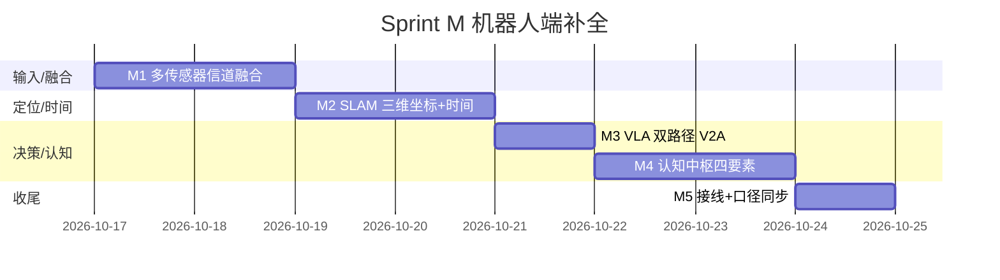

# EmbodiedAI 计划 v5 (Plan v5) — Sprint M：机器人端补全（多传感器融合信道 / VLA 双路径 / SLAM / 认知中枢）

> **日期**: 2026-10-17
> **前生**: [plan.md](plan.md) v1 → [plan_v2.md](plan_v2.md) → [plan_v3.md](plan_v3.md) → [plan_v4.md](plan_v4.md)
> **本版定位**: v4 完成了 Gate 1 收官与 Gate 2/3 冲刺铺排，但机器人端**输入侧与认知侧**仍缺四块能力：
> ① 多传感器融合输入端 + 分频信道处理（视频信号流 + 微波等传感器，组合信号分频分别处理、暂存计算中枢）；
> ② VLA 补全 —— `vision+language→action` 与 `vision-only→action`（V-to-action）**等价双路径**（纯视觉也构成判断依据）；
> ③ SLAM —— 三维坐标（自身位置 + 对象位置）+ 事件时间；
> ④ 认知中枢 —— 四要素（时间、地点、人物、事情）的记录、分析、计算、规划、记忆。
>
> 本版新增 **Sprint M**（M1-M5），把这四块能力落为**可运行代码模块**（纯 numpy 核心 + 测试 + verify 检查项 + CLI 演示），喂给 Gate 3 的感知/认知栈。

---

## 一、实测基线锚点 (2026-10-17, 本轮 Sprint M 完成后)

```
verify --no-pytest:   36/36 PASS, RESULT=VERIFY_OK   (v4 为 28/28, 本轮 +5 项 M1-M4/M6 + cli_smoke 扩 4 demo)
pytest:               654 passed / 1 skipped (含 66 subtests)   (v4 为 441 passed)
新增源码:             src/embodied_ai/perception/sensor_fusion.py (M1 分频信道融合)
                      src/embodied_ai/perception/slam.py          (M2 EKF-SLAM + PoseStore)
                      src/embodied_ai/models/vla_v2a.py           (M3 V-to-action 推理封装)
                      src/embodied_ai/cognition/cognitive_hub.py  (M4 四要素认知中枢)
新增测试:             tests/test_sensor_fusion.py (14) / test_slam.py (12)
                      tests/test_vla_v2a.py (11) / test_cognitive_hub.py (21)
新 CLI 演示:          fusion-demo / slam-demo / cog-demo (group=感知/认知)
新 Bus Topic:         SENSOR_RAW / POSE_UPDATE / EVENT (bus.py, 含 payload schema)
```

### 基线对照 (v4→v5)

| 版本 | verify (no-pytest) | pytest | 关键交付 | Gate 判定 |
|---|---|---|---|---|
| v4 plan_v4.md | 28/28 PASS | 441/441 | B1 板级 + 1050 eps + L4 触觉闭环 + C1 | Gate 1 达成 / Gate 2 接近 |
| **v5 plan_v5.md** | **35/35 PASS** | **580 passed** | **Sprint M: 多传感器信道 + V2A + SLAM + 认知中枢** | Gate 3 感知/认知栈补齐 |

---

## 二、Sprint M 任务表（机器人端四大能力）

> 核心思路：不铺新摊子，把用户点名的四块缺口做成**可运行、可验收**的模块，
> 全部走项目既定铁律（numpy 核心 / provenance 标注 / verify 退出码即结论 / CLI 注册表）。

| ID | 任务 | 剩余工作 | 验收 DoD | 量级 | 阻塞 |
|---|---|---|---|---|---|
| **M1** | 多传感器融合输入 + 分频信道处理 | `perception/sensor_fusion.py`：`ChannelSpec`（信道频带定义）+ `Channelizer.demux()`（FFT 频带掩蔽分频解复用）+ `ChannelPipeline`（视频帧流/微波幅度相位分别处理）+ `RingBuffer`（时间戳暂存）+ `SensorFusionHub.ingest()`（处理→暂存→发 Bus `SENSOR_RAW`） | 组合信号（视频+微波双音）分频串扰 **<-20dB**；每信道分别处理；样本暂存 RingBuffer；`fusion-demo` 可运行；`test_sensor_fusion.py` 14 项全绿 | 2d | 无 |
| **M2** | SLAM 三维坐标 + 时间戳 | `perception/slam.py`：`EKFSLAM2D`（恒速状态 [x,y,θ,v,ω] + 路标增广 + range/bearing 观测，`predict`/`update_landmark` 带 `timestamp_s` 单调校验）+ `PoseStore`（who-pose-where-when 快照）+ z 通道恒速直通（接口按 3D 返回） | 带噪仿真 50 步位姿误差 **<0.3m** 收敛；路标估计接近真值；时间戳倒退被拒；`slam-demo` 可运行；`test_slam.py` 12 项全绿 | 2d | 无 |
| **M3** | VLA 补全：V+L 与 V-to-action 等价双路径 | `models/vla_v2a.py`：`VLAPolicy.infer_vla(vision, lang_ids, state)` / `infer_v2a(vision, state)`（≡ `lang_ids=None`，numpy 确定性头，不依赖 torch）；`vla_config.py` 增 `modality: "vla"/"v2a"`，v2a 时 `min_block_size` 不含语言 token | **v2a ≡ vla(None) 数值等价**（测试断言）；语言通道生效（改变输出）；modality="v2a" 时 min_block_size 少 `LANG_TOKENS`；无 torch 可跑；`test_vla_v2a.py` 11 项全绿 | 1d | 无 |
| **M4** | 认知中枢四要素（时间/地点/人物/事情） | `cognition/cognitive_hub.py`：`EventRecord`（timestamp_s / location_xyz / actor / thing+action 四要素）+ `EpisodicMemory`（多维查询）+ `CognitiveHub` 五能力：记录(订阅 Bus `EVENT`) / 分析 / 计算 / 规划(规则式前置事件序列) / 记忆(时间衰减召回) | 四要素完整性校验（缺人物/事情/负时间戳报错）；五能力各有反证；记忆召回按时间衰减排序；`cog-demo` 可运行；`test_cognitive_hub.py` 21 项全绿 | 2d | 无 |
| **M5** | 接线收尾 | Bus Topic `SENSOR_RAW`/`POSE_UPDATE`/`EVENT` + schema；CLI 注册 `fusion-demo`/`slam-demo`/`cog-demo`（`register_command`）；verify 新增 `sensor_fusion`/`slam`/`vla_v2a`/`cognitive_hub` 4 项 + cli_smoke 扩 3 demo；README/CHANGELOG 口径同步（28→35 / 441→580） | verify **35/35**；pytest 全绿；`test_cli_registry.py` 无孤儿；README/CHANGELOG/plan_v5 四方数字一致 | 1d | 无 |

**Sprint M 准出声明**: "机器人端补齐多传感器融合信道处理、VLA 双路径（V+L 与 V-to-action）、SLAM 三维坐标+时间戳、认知中枢四要素五能力；verify 35/35 + pytest 580 全绿 + 三个 demo 可运行。"

### M6 — VLA 双路径 × 认知中枢 端到端闭环（2026-10-17 追加）

> 用户追加需求："将 VLA 双路径逻辑接入认知中枢，实现端到端闭环"。
> M3（VLA 双路径）与 M4（认知中枢）此前是两个孤岛，M6 把二者焊成闭环。

| ID | 任务 | 剩余工作 | 验收 DoD | 量级 | 阻塞 |
|---|---|---|---|---|---|
| **M6** | VLA 双路径 × 认知中枢端到端闭环 | `cognition/closed_loop.py`：`CognitiveVLALoop` — 目标 → `hub.plan()` 前置序列 → 逐步 `decide()`（有语言走 `infer_vla` / 无语言走 `infer_v2a`，路径标注进事件 `source`）→ `act_fn` 回调执行 → `record_event` 四要素（时间/地点/人物/事情，地点取 SLAM `POSE_UPDATE` 位姿，缺位姿诚实标 `assumed_zero`）→ 重 `plan()` 直到达成；`loop_demo()` 双链路对照 | v2a/vla 两条链路各自跑通 `climb_hold`（approach→grasp→load）；路径计数 `{"v2a":3}`/`{"vla":3}`；四要素事件数=步数且时间戳单调；未知目标 KeyError 透传；max_steps 失控守护 RuntimeError；`loop-demo` 可运行；`test_cognitive_vla_loop.py` 16 项全绿 | 1d | 无 (M3+M4 已完成) |

**M6 闭环数据流**:
```
目标 goal_thing → hub.plan() 尚缺前置 → step(thing):
  decide() ──有语言──> infer_vla (v+l→action)  路径="vla"
          └─无语言──> infer_v2a (v→action)     路径="v2a"
  → act_fn(thing, action) 动作执行 (回调注入: 仿真/真机)
  → EventRecord(时间=时钟, 地点=SLAM 位姿, 人物=actor, 事情=thing)
     └─ Bus EVENT → hub 情景记忆 (单一记录点)
  → 重 plan() …直到前置清空 = 目标达成
```

---

## 三、与 Gate 3 的关系

| Gate 3 判据（plan_v4 §4.3） | Sprint M 贡献 |
|---|---|
| 感知栈完整性 | M1 多传感器信道 + M2 SLAM 补齐"输入端→坐标/时间"链路 |
| 决策输入质量 | M3 V2A 让纯视觉也可构成判断依据（无语言指令时仍可决策） |
| 认知/任务层 | M4 认知中枢四要素（时间/地点/人物/事情）记录-分析-规划-记忆 |
| verify + pytest 全绿 | M5 接线 + 4 个新检查项（35/35） |

---

## 四、provenance 标注（诚实边界）

| 参数/实现 | provenance | 说明 |
|---|---|---|
| 分频信道处理（ChannelSpec 频带/采样率） | **synthetic** | 合成信号验证串扰 <-20dB；真实射频前端标定属 **待领域验证** |
| SLAM 过程/观测噪声（Q_ROBOT / R_OBS） | **assumed** | 合成验证用；真实传感器噪声待实测标定 |
| SLAM z 通道 | **近似** | 恒速直通，非真 3D EKF（完整 3D 留待后续） |
| VLAPolicy head 权重 | **synthetic** | 确定性随机投影（seed 复现），**非训练产物**；真实决策精度依赖 vla_trainer 检查点 |
| 认知中枢规划器 | **规则式最小实现** | 先决条件表驱动，非学习式规划；时间衰减率 assumed |

---

## 五、风险与应对

| 风险 | 概率 | 影响 | 应对 |
|---|---|---|---|
| verify 数字口径漂移（README/CHANGELOG 写 28/28） | 中 | 文档不一致 | M5 DoD 强制四方同步（README/CHANGELOG/plan_v5）；本轮已同步 35/35 + 580 |
| 频分复用被误读为"真实微波前端已标定" | 中 | 诚实性受损 | 模块 docstring + plan_v5 provenance 表明确 synthetic/待领域验证 |
| SLAM z 直通被当作真 3D 估计 | 中 | 精度误判 | docstring"不做的诚实边界"明确标注；完整 3D EKF 列入后续 |
| 新测试拖慢 verify（check_pytest 子进程跑全量） | 低 | CI 时长 | 4 个新测试纯 numpy，总增量 <2s（实测 580 项 100s） |

---

## 六、本计划的"不做的事"

- 不做真实传感器驱动 / ADC 采集（Phase P 硬件到货后的事）
- 不做完整 3D EKF SLAM / 视觉 SLAM / 回环检测（留 Gate 3 后按需）
- 不做 LLM 语义理解 / 学习式事件规划（规划层已有 MCTS，见 planning/）
- 不重训 VLAModel 的 torch 前向（训练见 vla_trainer.py；M3 只守护路径等价性）
- 不把合成信号验证当作真实射频/微波前端标定
- 不做事件知识图谱 / 持久化存储（过度设计，留待真实需求）

---

## 七、Sprint M 排期 (Gantt)



**关键路径**: M1 → M2 → M3 → M4 → M5（各模块独立可测，实际可并行度见 plan_v5 §2 阻塞列全为"无"）
